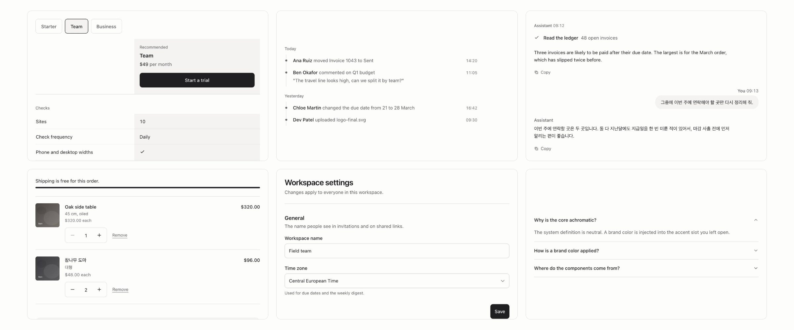
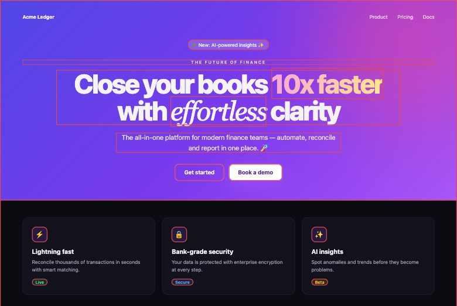
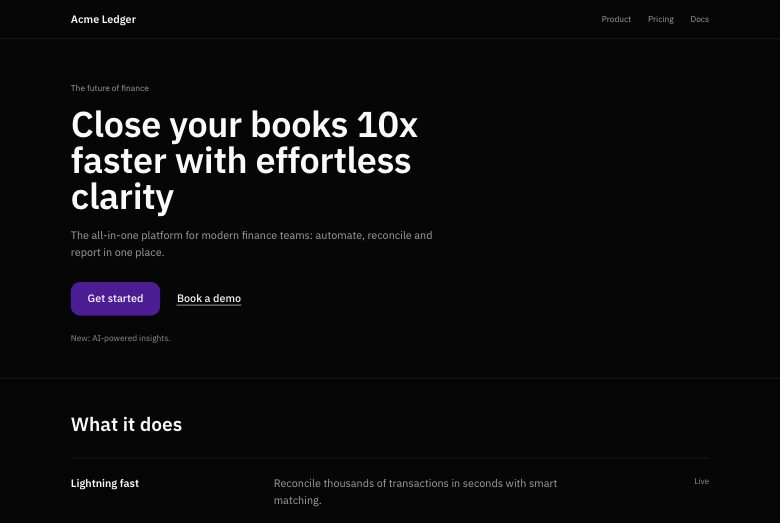

# Taster

[English](README.md) | 한국어

[](https://github.com/makim-414/taster/actions/workflows/validate.yml) [](LICENSE) [](#설치)

프론트엔드에서 AI 티가 나는 곳(슬롭)을 찾고, 그 자리를 같은 일을 더 잘하는 패턴으로 갈아 끼우거나, 처음부터 슬롭 없이
화면을 짓습니다.


[사이트](https://taster-six.vercel.app) | [실제로 보기](https://taster-six.vercel.app/demo) | [부품](https://taster-six.vercel.app/components) | [규칙](data/rules/RULES.md) | [패턴](data/patterns/README.md) | [안내서](docs/guide.ko.md) | [변경 기록](CHANGELOG.md)

## <a id="스킬"></a>설치

Claude Code 에서:

```text
/plugin marketplace add makim-414/taster
/plugin install taster@taster
```

한 번 설치하면 네 가지가 들어옵니다. Codex 는 같은 플러그인을 `.codex-plugin/` 에서 읽습니다.

| 부품 | 하는 일 |
|---|---|
| MCP 서버 | 엔진. 실제 브라우저에서 하는 진단, 브랜드, 디자인 시스템, 화면, `add` |
| 스킬 | 규칙과 패턴, 언제 무엇을 쓰는지 |
| 훅 | 에이전트가 일하는 동안 고친 곳을 라이브 뷰어로 보냄 |
| `/taster` | 시작 명령 |

Node.js 22 이상과 Google Chrome 이나 Playwright 의 Chromium 이 필요합니다. 스킬만은 `SKILL.md` 를 읽는 어느
에이전트에서나 돕니다.

```bash
npx skills add https://github.com/makim-414/taster --skill taster
```

명령줄, 원격 MCP 서버, GitHub Action, 확장 등 다른 모든 방법은 [안내서](docs/guide.ko.md) 에 있습니다.

## 들어 있는 것

- **규칙.** 규칙 88개, 그중 85개는 `data/rules/detect.js` 가 실제 브라우저에서 재고 나머지는 캡처를 보고 눈으로 판단합니다. 대문자에 넓은 자간을 준 라벨, 색을 옅게 깐 알약 배지, 카드 왼쪽의 두꺼운 색 띠, 이모지 불릿, 단어 중간에서 끊기는 한글 줄바꿈 같은 것들입니다. 걸렸다는 것은 그 페이지에 그 흔적이 있다는 뜻이지, 누가 무엇으로 만들었는지를 말하지 않습니다([규칙의 근거](#규칙의-근거)).
- **패턴.** 패턴 122개. 방문자가 하려는 일(요금제 비교, 믿을 근거 확인, 상태 표시)과 화면 종류(랜딩, 대시보드, 쇼핑, AI 대화 등)로 정리했습니다. 규칙마다 그것을 고치는 패턴이 연결돼 있습니다.
- **부품.** 부품 152개. 토큰으로 만든 React 컴포넌트이고, Tailwind 와 Taster 프리셋으로 스타일을 입힙니다. 부품 라이브러리를 설치하지 않고 필요한 파일만 복사해 쓰며, 지워야 할 남의 브랜드도 없습니다.

<picture>
  <source media="(prefers-color-scheme: dark)" srcset=".github/assets/components.dark.jpg">
  <source media="(prefers-color-scheme: light)" srcset=".github/assets/components.light.jpg">
  
</picture>

설치 없이 써 보기: https://taster-six.vercel.app 에 주소를 넣으면 데스크톱과 폰 폭 캡처 위에 걸린 규칙을
표시해 줍니다.

**[부품 갤러리 보기](https://taster-six.vercel.app/components).** 모든 부품이 실제로 돌아갑니다. 눌러 보고, 내 브랜드 색을 입혀 보고,
내 사이트에서 브랜드를 읽어 오고, 몇 개를 나란히 놓고 비교할 수 있습니다. 호스팅 화면은 지금 한국어로만 나오고,
비교 화면이 에이전트에게 넘길 글은 브라우저 언어를 따릅니다.

## 하는 일

시작할 때 늘 한 가지를 먼저 묻습니다. **"이미 있는 사이트인가요, 아니면 새로 지을까요?"** 답에 따라 길이 갈리고,
어느 길이든 같은 순서로 갑니다. 진단(이미 있는 사이트만), 브랜드와 레퍼런스, 함께 정하는 디자인 시스템, 화면
순서입니다. 화면마다 그 목적에 맞는 부품으로 짓고, 모든 화면이 그 시스템을 입습니다([SKILL.md](skills/taster/SKILL.md)).

| 길 | 넣는 것 | 받는 것 |
|---|---|---|
| 이미 있는 사이트, 코드가 작업 폴더에 있음: 진단, 브랜드, 시스템, 교체 | 주소나 개발 서버, 그리고 코드 | 슬롭인 곳마다 표시한 캡처, 그다음 내 코드에서 그 자리를 갈아 끼우고 다시 검사해 깨끗해진 페이지 |
| 이미 있는 사이트, 주소만 있음: 진단, 브랜드, 시스템, 다시 짓기 | 주소(빌더로 만든 사이트, 고칠 수 없는 템플릿, 코드를 잃어버린 사이트) | 같은 글, 링크, 브랜드를 패턴으로 다시 지은 새 페이지. 검사 0건을 확인하고 원본과 나란히 보여 줌 |
| 새 사이트: 브랜드, 시스템, 빌드 | 제품, 대상, 화면 종류, 실제 내용, 브랜드와 마음에 드는 페이지 | 패턴으로만 조립하고 미리 검사한 새 화면 |

다시 짓기와 브랜드 흡수는 내 사이트이거나 다시 지을 권한이 있는 사이트에만 씁니다. 브랜드 단계는 그 사이트의 브랜드
색, 글꼴, 로고를 읽어 토큰 테마(`theme.css`)로 만들고, 성공·실패 색도 브랜드 색과 헷갈리지 않게 맞춥니다.

화면이 여럿이면 한 화면씩, 또는 한 부분씩 짓습니다. 브랜드와 토큰이 먼저 시스템이 되고, 화면마다 만드는 사람에게
먼저 제안해 동의를 받은 뒤에만 목적에 맞는 부품으로 짓고, 다음 화면으로 넘어가기 전에 검사합니다. 검사기 0건, 그리고
`check_consistency` 의 어긋남 0건입니다. 이 도구는 모든 화면을 그려서 같은 부품이 두 화면에서 다르게 그려진 곳과
시스템 토큰이 아닌 값을 알려 줍니다. 순서는 `taster.plan.json` 이 지키고, 순서를 건너뛰는 단계는 거부합니다
([screens.md](skills/taster/references/screens.md)).

프론트엔드에서 AI 티가 나는 곳(슬롭)을 찾고, 그 자리를 같은 일을 더 잘하는 패턴으로 갈아 끼우거나, 처음부터 슬롭 없이 화면을 짓습니다.

[사이트](https://taster-six.vercel.app) | [부품](https://taster-six.vercel.app/components) | [규칙](data/rules/RULES.md) | [패턴](data/patterns/README.md) | [변경 기록](CHANGELOG.md) | [기여 안내](CONTRIBUTING.md)

| 고치기 전 | 고친 뒤 |
|---|---|
|  |  |

고치기 전: 지어낸 랜딩 페이지 Acme Ledger(18개 규칙에 걸림). 걸린 곳마다 Taster 가 테두리를 쳤습니다. 고친 뒤: 같은 내용을 규칙에 맞게 다시 지어 1440 과 390 폭 모두 0건입니다. 두 페이지와 이를 증명하는 검사는 [`examples/rebuild/`](examples/rebuild/) 에 있습니다.

`examples/rebuild/` 에 위 그림의 다시 짓기 예시가 있습니다. AI 티 나는 랜딩을 다시 지어 두 폭 모두 0건,
제목·버튼·메뉴는 하나도 빠지지 않고 브랜드 색도 그대로입니다. 같은 부품으로 지은 두 번째 화면도 있고, 첫 화면과
어긋나지 않고 시스템 안에 있는지 확인합니다. `node packages/engine/scripts/check-rebuild-example.mjs` 가 그림 아래 적은 규칙
수까지 모두 확인합니다.

`examples/icon-slots/` 에는 아이콘 자리(조작, 설명용, 식별 마크, 데이터 표식, 아이콘 없음)마다 변형 5개씩, `taxonomy.json` 에
적힌 25개가 그대로 있습니다. `node packages/engine/scripts/check-icon-slots-example.mjs` 가 분류 체계와 맞는지, 두 폭 모두 0건인지
확인합니다.

## 디자인 시스템

화면을 짓기 전에 브랜드와 만드는 사람의 의도를 먼저 하나의 디자인 시스템으로 만듭니다. 브랜드 사이트와 마음에 드는
톤의 페이지 한두 개를 넣으면 실제 브라우저에서 잽니다(모서리 둥글기, 간격과 버튼 높이, 글자 대비, 글자 크기 비율,
색상 수, 그림자, 움직임, 테두리). 여덟 축을 각각 이름 있는 단계에 놓고, 제약으로 적은 디자인 원칙에 맞춰 균형을
잡으므로 애매한 중간값이 생기지 않습니다. 축 하나를 움직이면 나머지는 꼭 필요한 만큼만 따라 움직이고, 어떤 원칙
때문에 움직였는지 그대로 알려 줍니다. 결과는 `taster.system.json` 과 `theme.css` 입니다. 축이 정하는 모든 토큰과
브랜드가 들어 있고, 글자 대비는 WCAG AA 이상입니다. 모든 화면과 부품이 이 파일을 불러 씁니다.

```bash
node packages/engine/cli.mjs --system https://your-site.example --ref ./a-page-you-like.html --out system
node packages/engine/cli.mjs --tune system/taster.system.json roundness=1
```

MCP 도구: `design_system`, `tune_system`, `system_for_category`. 측정값이 단계로, 단계가 토큰으로 바뀌는 방식은
`skills/taster/references/system.md` 에 있습니다.

## 개인정보

호스팅 사이트(https://taster-six.vercel.app, 원격 MCP 서버 포함)에는 분석 스크립트와 쿠키가 없습니다. 넣은 주소와
돌려준 결과를 저장하지 않습니다. 열지 못한 페이지는 주소가 아니라 호스트 이름만 오류 기록에 남습니다. 진단 화면은 주소를
링크의 `#url=` 뒤에 두는데, 브라우저는 이 부분을 보내지 않으므로 새로고침하거나 링크를 나눠도 주소가 요청에 실리지
않습니다. 속도 제한에 쓰는 IP 주소는 서버 메모리에만 있다가 인스턴스가 다시 뜨면 사라집니다. 톤 지도가 여는 첫 화면(다른
사이트, 요청할 때만)은 서버 메모리에 최대 30분 머물고 디스크에 쓰지 않습니다. 갤러리에서 고른 설정은 이 브라우저
안(`localStorage`)에만 남습니다. 호스팅을 맡은 Vercel 이 남기는 요청 기록은
[Vercel 의 개인정보 정책](https://vercel.com/legal/privacy-policy)을 따릅니다.

로컬 도구, 북마클릿, 확장은 측정 결과를 어디로도 보내지 않고 원격 측정도 없습니다. `taster watch` 가 돌고 있을
때만 로컬 도구가 호출 하나하나를, 수정 훅이 고친 파일의 경로를 127.0.0.1 의 그 허브에 알리고, 다른 곳으로는 보내지
않습니다.

## 분류 체계 한눈에

분류마다 한 문장 정의, 포함하는 것, 제외하는 것과 그것이 대신 가는 곳, 일반적인 예시가 있습니다. 예·아니오로 답하는
특징 33개에 대한 결정 키가 모든 UI 부품을 분류 하나에 정확히 넣고, 처음 맞는 단계가 이깁니다. 가중치 축은
`packages/registry/src/tokens.css` 의 이름 있는 속성을 움직이고, 정해진 단계에만 놓여 애매한 중간값이 없으며, 선형 제약으로
적은 디자인 원칙이 균형을 지킵니다(빽빽한 화면에 포스터 같은 글자는 올 수 없고, 깊은 그림자에는 절제된 색이 필요합니다).
`data/taxonomy/axes.mjs` 가 설정을 검사하고 균형을 맞춥니다. 자세한 내용은 [data/taxonomy/SCHEMA.md](data/taxonomy/SCHEMA.md) 에
있고, 묶음별 분류와 패턴 수 표는 영어 README 의 [Taxonomy at a glance](README.md#taxonomy-at-a-glance) 에 있습니다(빌드가
자동으로 씁니다).

## 규칙의 근거

<!-- rules:start -->
규칙 88개, 그중 85개는 실제 브라우저에서 재고 3개는 캡처를 보고 눈으로 판단합니다. 규칙마다 `data/rules/rules.json` 의 `basis` 에 근거가 적혀 있습니다. 53개는 생성된 페이지를 다룬 외부 글, 18개는 웹 표준이나 플랫폼 가이드, 49개는 Taster 가 직접 본 것에 근거하고, 그중 21개는 직접 본 것만이 근거입니다. 한 규칙이 여러 근거를 가질 수 있습니다.

인용한 외부 글(많이 인용한 순): Signs of AI design; kill-ai-slop; AI Slop Detector by Made with Jev; Impeccable slop catalog; Adrian Krebs, AI design patterns in Show HN pages; taste-skill; Anthropic frontend-design skill; slop-detect; prg.sh, why AI keeps building the same purple gradient; 925 Studios, AI slop design tells; Solo Design, AI design slop tells; Paul Bakaus, Impeccable 3.5 launch post; Hallmark; css-slop-detector.
<!-- rules:end -->

외부 글이나 표준은 링크, 읽은 날짜, 규칙을 뒷받침하는 내용을 담은 ref 로 적습니다. 그 내용은 15단어 이하의 인용이거나,
요약이라고 표시한 Taster 의 한 줄입니다. 다른 글을 옮긴 글은 `derived_from` 에 원래 글을 적습니다. 출처는 각자의
라이선스를 따르고, Taster 는 링크만 걸 뿐 글도 코드도 가져오지 않습니다. Taster 가 직접 본 것은 규칙의 `observation`
에 적습니다. `node packages/engine/scripts/check-rules.mjs` 가 모든 규칙의 근거와 ref 를 검사합니다.

규칙 하나에 걸렸다고 AI 가 만들었다는 뜻은 아닙니다. 표준에 근거한 규칙은 누가 만들었든 화면 품질의 문제이고, 사람이
손으로 만든 페이지도 다른 규칙에 걸릴 수 있습니다.

## 한국어 웹

한글 줄바꿈(`word-break: keep-all`), 한글 글꼴 대체 순서, 한글 행간, `lang="ko"` 같은 규칙이 따로 있습니다.
영어권 도구들이 거의 다루지 않는 부분입니다.

## 리포 구성

폴더마다 무엇이 있는지, 옮기면 안 되는 경로, 생성 파일은 [AGENTS.md](AGENTS.md)(영어) 에 있습니다.

## 개발

소스를 고친 뒤 CI 가 돌리는 모든 검사를 같은 순서로 돌립니다.

```bash
node scripts/gates.mjs           # 네 작업 전부(npm test 도 같음), 빠진 것은 먼저 설치
node scripts/gates.mjs browser   # 작업 하나: validate, browser, web, action
```

준비, 검사 하나하나, 생성 파일, 다른 곳에서 온 코드와 그림에 대한 규칙은 [CONTRIBUTING.md](CONTRIBUTING.md) 에
있습니다. 취약점은 [SECURITY.md](SECURITY.md) 에 적힌 대로 비공개로 알려 주세요.

## 원칙

- 먼저 재고, 그다음 판단합니다. 스타일에서 계산할 수 있는 규칙은 짐작하지 않고 계산합니다.
- 부품보다 토큰을 먼저 고칩니다. 강조색 하나, 중립 바탕, 크기와 굵기와 여백으로 만드는 위계.
- 자리 채우기 글보다 실제 내용. 지어낸 숫자도, 가짜 추천사도 없습니다.
- 검사기가 깨끗하다는 것은 목록에 있는 흔적이 사라졌다는 뜻이지, 디자인이 좋다는 뜻이 아닙니다. 에이전트는 확인하지
  못한 것을 말합니다.

## 라이선스

MIT, [LICENSE](LICENSE) 를 보세요. 이 리포에 들어간 외부 코드(컴포넌트 모음과 웹)는
[THIRD_PARTY_NOTICES.md](THIRD_PARTY_NOTICES.md) 에 적었습니다.
