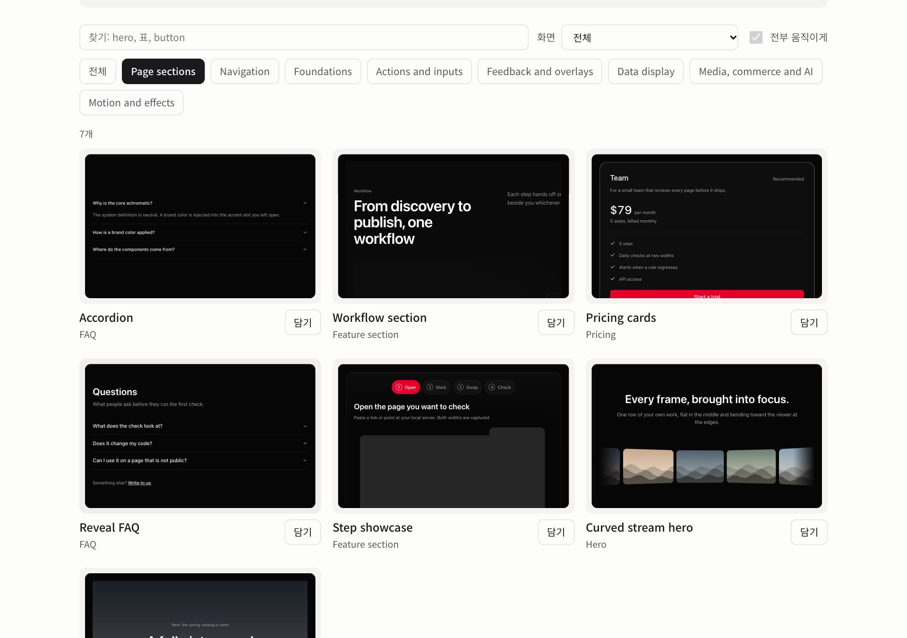
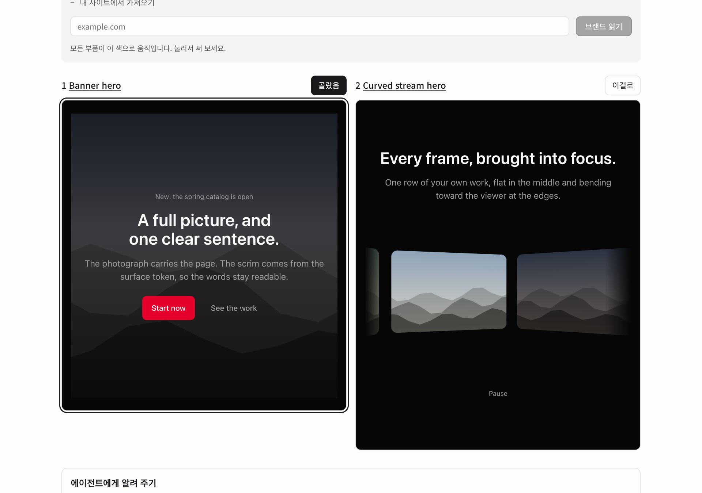

# Taster

[English](README.md) | 한국어

프론트엔드에서 AI 티가 나는 곳(슬롭)을 찾고, 그 자리를 같은 일을 더 잘하는 패턴으로 갈아 끼우거나, 처음부터
슬롭 없이 화면을 짓습니다.

Taster 는 코딩 에이전트(Claude Code, Codex, Cursor 등 `SKILL.md` 를 읽는 모든 도구)에 넣어 쓰는 스킬이자
플러그인입니다. 에이전트는 세 가지를 함께 씁니다.

- **규칙.** AI 가 자주 남기는 흔적과 화면 품질 문제를 잴 수 있을 만큼 정확하게 적은 목록입니다. 대문자에 넓은 자간을
  준 라벨, 색을 옅게 깐 알약 배지, 카드 왼쪽의 두꺼운 색 띠, 이모지 불릿, 똑같은 아이콘 카드 세 장, 단어 중간에서
  끊기는 한글 줄바꿈 같은 것들입니다. 규칙 88개, 그중 85개는 `rules/detect.js` 가 실제 브라우저에서 잽니다. 나머지는
  캡처를 보고 눈으로 판단합니다. 걸렸다는 것은 그 페이지에 그 흔적이 있다는 뜻이지, 누가 무엇으로 만들었는지를
  말하지 않습니다([규칙의 근거](#규칙의-근거)).
- **패턴 분류 체계.** 패턴 122개. 방문자가 하려는 일(숫자 하나 보기, 요금제 비교, 믿을 근거 확인, 상태 표시)과
  화면 종류(랜딩, 대시보드, 앱, 쇼핑, 읽을거리, 로그인, AI 대화)로 정리한 재사용 디자인 답안입니다. 화면의 모든
  부품은 기계로 판정하는 결정 키를 거쳐 분류 하나에 정확히 들어가고, 밀도, 대비, 둥글기, 타입 표현, 색 절제, 깊이,
  모션, 선 굵기의 여덟 가중치 축이 브랜드의 톤을 토큰으로 옮깁니다. 규칙마다 그것을 고치는 패턴이 연결돼 있습니다.
- **컴포넌트 모음.** 부품 144개. 토큰으로 만든 React 컴포넌트입니다. 설치할 패키지 없이 필요한 파일만 복사해 쓰고,
  지워야 할 남의 브랜드도 없습니다.

설치 없이 써 보기: https://taster-six.vercel.app 에 주소를 넣으면 데스크톱과 폰 폭 캡처 위에 걸린 규칙을
표시해 줍니다.

**[부품 갤러리 보기](https://taster-six.vercel.app/components).** 모든 부품이 실제로 돌아갑니다. 눌러 보고, 내 브랜드 색을 입혀 보고,
내 사이트에서 브랜드를 읽어 오고, 몇 개를 나란히 놓고 비교할 수 있습니다. 호스팅 화면은 지금 한국어로만 나오고,
비교 화면이 에이전트에게 넘길 글은 브라우저 언어를 따릅니다.



## 하는 일

시작할 때 늘 한 가지를 먼저 묻습니다. **"이미 있는 사이트인가요, 아니면 새로 지을까요?"** 답에 따라 길이 갈리고,
어느 길이든 같은 순서로 갑니다. 진단(이미 있는 사이트만), 브랜드와 레퍼런스, 함께 정하는 디자인 시스템, 화면
순서입니다. 화면마다 그 목적에 맞는 부품으로 짓고, 모든 화면이 그 시스템을 입습니다([SKILL.md](skills/taster/SKILL.md)).

| 길 | 넣는 것 | 받는 것 |
|---|---|---|
| 이미 있는 사이트, 코드가 작업 폴더에 있음: 진단, 브랜드, 시스템, 교체 | 주소나 개발 서버, 그리고 코드 | 슬롭인 곳마다 표시한 캡처, 그다음 내 코드에서 그 자리를 갈아 끼우고 다시 검사해 깨끗해진 페이지 |
| 이미 있는 사이트, 주소만 있음: 진단, 브랜드, 시스템, 다시 짓기 | 주소(빌더로 만든 사이트, 고칠 수 없는 템플릿, 코드를 잃어버린 사이트) | 같은 글, 링크, 브랜드를 패턴으로 다시 지은 새 페이지. 검사 0건을 확인하고 원본과 나란히 보여 줌 |
| 새 사이트: 브랜드, 시스템, 빌드 | 제품, 대상, 화면 종류, 실제 내용, 브랜드와 마음에 드는 페이지 | 패턴으로만 조립하고 미리 검사한 새 화면 |

다시 짓기와 브랜드 흡수는 내 사이트이거나 다시 지을 권한이 있는 사이트에만 씁니다. 브랜드 단계는 그 사이트의 브랜드
색, 글꼴, 로고를 읽어 토큰 테마(`theme.css`)로 만들고, 성공·실패 색도 브랜드 색과 헷갈리지 않게 맞춥니다.

화면이 여럿이면 한 화면씩, 또는 한 부분씩 짓습니다. 브랜드와 토큰이 먼저 시스템이 되고, 화면마다 만드는 사람에게
먼저 제안해 동의를 받은 뒤에만 목적에 맞는 부품으로 짓고, 다음 화면으로 넘어가기 전에 검사합니다. 검사기 0건, 그리고
`check_consistency` 의 어긋남 0건입니다. 이 도구는 모든 화면을 그려서 같은 부품이 두 화면에서 다르게 그려진 곳과
시스템 토큰이 아닌 값을 알려 줍니다. 순서는 `taster.plan.json` 이 지키고, 순서를 건너뛰는 단계는 거부합니다
([screens.md](skills/taster/references/screens.md)).

`examples/rebuild/` 에 다시 짓기 예시가 있습니다. AI 티 나는 랜딩(18개 규칙에 걸림)을 다시 지어 두 폭 모두 0건,
제목·버튼·메뉴는 하나도 빠지지 않고 브랜드 색도 그대로입니다. 같은 부품으로 지은 두 번째 화면도 있고, 첫 화면과
어긋나지 않고 시스템 안에 있는지 확인합니다. `node engine/scripts/check-rebuild-example.mjs` 가 이 숫자까지 모두
확인합니다.

`examples/icon-slots/` 에는 아이콘 자리(조작, 설명용, 식별 마크, 데이터 표식, 아이콘 없음)마다 변형 5개씩, `taxonomy.json` 에
적힌 25개가 그대로 있습니다. `node engine/scripts/check-icon-slots-example.mjs` 가 분류 체계와 맞는지, 두 폭 모두 0건인지
확인합니다.

## 디자인 시스템

화면을 짓기 전에 브랜드와 만드는 사람의 의도를 먼저 하나의 디자인 시스템으로 만듭니다. 브랜드 사이트와 마음에 드는
톤의 페이지 한두 개를 넣으면 실제 브라우저에서 잽니다(모서리 둥글기, 간격과 버튼 높이, 글자 대비, 글자 크기 비율,
색상 수, 그림자, 움직임, 테두리). 여덟 축을 각각 이름 있는 단계에 놓고, 제약으로 적은 디자인 원칙에 맞춰 균형을
잡으므로 애매한 중간값이 생기지 않습니다. 축 하나를 움직이면 나머지는 꼭 필요한 만큼만 따라 움직이고, 어떤 원칙
때문에 움직였는지 그대로 알려 줍니다. 결과는 `taster.system.json` 과 `theme.css` 입니다. 축이 정하는 모든 토큰과
브랜드가 들어 있고, 글자 대비는 WCAG AA 이상입니다. 모든 화면과 부품이 이 파일을 불러 씁니다.

```bash
node engine/cli.mjs --system https://your-site.example --ref ./a-page-you-like.html --out system
node engine/cli.mjs --tune system/taster.system.json roundness=1
```

MCP 도구: `design_system`, `tune_system`, `system_for_category`. 측정값이 단계로, 단계가 토큰으로 바뀌는 방식은
`skills/taster/references/system.md` 에 있습니다.

## 설치

### 필요한 것

- Node.js 22 이상(`.nvmrc` 의 버전)과 git. MCP 서버, 명령줄, `add` 는 이 리포를 받은 클론에서 실행합니다. npm
  패키지는 아직 게시 전입니다.
- 페이지를 여는 기능에는 브라우저가 필요합니다. Playwright 의 Chromium 이 있으면 그것을, 없으면 설치된 Google
  Chrome 을 씁니다. 클론에서 `node engine/setup.mjs` 를 실행하면 둘 중 하나가 뜨는지 확인하고, 둘 다 안 될 때만
  Chromium 을 받습니다. 소스 린트에는 브라우저가 필요 없습니다.

### 스킬

스킬을 지원하는 에이전트:

```bash
npx skills add https://github.com/makim-414/taster --skill taster
```

### Claude Code 플러그인

```text
/plugin marketplace add makim-414/taster
/plugin install taster@taster
```

플러그인에는 스킬, `/taster` 명령, 로컬 MCP 서버가 함께 들어 있습니다. 서버를 처음 켤 때 엔진 의존성을 설치하는데,
Claude Code 가 서버 연결을 기다리는 시간보다 길어질 수 있습니다. `/mcp` 에서 `taster` 가 실패로 보이면 설치가 끝난
뒤 그 화면에서 다시 연결하세요.

### 다른 클라이언트에서 MCP 서버 쓰기

리포를 받아 엔진을 한 번 설치한 뒤, 클라이언트에 `engine/start.mjs` 를 연결합니다.

```bash
git clone https://github.com/makim-414/taster.git /path/to/taster
npm ci --prefix /path/to/taster/engine
```

플러그인 없이 Claude Code:

```bash
claude mcp add taster -- node /path/to/taster/engine/start.mjs
```

Codex 는 `~/.codex/config.toml` 에 넣습니다(리포를 Codex 플러그인으로 설치하면 `.codex-plugin/plugin.json` 이 스킬과
이 서버를 함께 넣습니다).

```toml
[mcp_servers.taster]
command = "node"
args = ["/path/to/taster/engine/start.mjs"]
```

Cursor 는 프로젝트의 `.cursor/mcp.json`, 모든 프로젝트에 쓰려면 `~/.cursor/mcp.json` 에 넣습니다.

```json
{ "mcpServers": { "taster": { "command": "node", "args": ["/path/to/taster/engine/start.mjs"] } } }
```

로컬 서버는 내 사용자 권한으로 돕니다. 받은 http, https 주소는 사설 주소까지 모두 열고(그래서 개발 서버를 잴 수
있습니다), 로컬 파일은 `.html`, `.htm`, `.xhtml`, `.svg` 만 엽니다. 서버 환경 변수 `TASTER_ROOT` 에 폴더를 주면
로컬 파일을 그 폴더 안에서만 엽니다. 페이지가 담은 글은 `<untrusted_page_content>` 블록 안에 담아 돌려주며,
에이전트가 읽을 데이터일 뿐 따를 지시가 아닙니다. 파일은 도구에 지정한 곳에만 쓰고, 연 페이지 말고는 어디로도 보내지
않습니다. 자세한 목록은 [SECURITY.md](SECURITY.md#what-the-local-tools-can-reach) 에 있습니다.

### 시작

Claude Code 에서 `/taster` 를 치면(또는 에이전트에게 "Taster 시작해줘") 이미 있는 사이트인지 새로 지을지부터
묻고 이어 갑니다. 바로 말해도 됩니다. "이 사이트 슬롭 진단해줘", "AI 사이트 빌더로 만든 내 사이트 AI 티 안 나게
다시 지어줘", "이 제품 요금제 페이지를 AI 티 안 나게 만들어줘".

## 쓰기

### 명령줄 (에이전트 없이)

클론에서:

```bash
npm ci --prefix engine
node engine/cli.mjs https://example.com --out ./taster-report
node engine/cli.mjs https://example.com --extract    # 다시 짓기에 쓸 페이지 내용
node engine/cli.mjs https://example.com --brand      # 사이트 브랜드를 토큰 테마로
```

봇 확인, 차단·오류 화면, 다른 호스트의 로그인 화면이 돌아오면 진단하지 않았다고 알리고 발견은 내놓지 않습니다(종료
코드 2). Taster 는 그런 화면을 우회하지 않습니다.

### 소스 린트

같은 규칙의 소스 코드 형태입니다. 리뷰와 CI 에 쓰고, 브라우저가 필요 없습니다. npm 패키지는 아직 게시 전이라 이
리포를 한 번 받아 두고 내 앱 폴더에서 그 CLI 를 실행합니다.

```bash
git clone https://github.com/makim-414/taster.git /path/to/taster   # 한 번만
npm ci --prefix /path/to/taster/engine                              # 한 번만
node /path/to/taster/engine/cli.mjs lint src                                  # 옅은 알약, transition-all, 하드코딩 색 ...
node /path/to/taster/engine/cli.mjs lint src --baseline taster-baseline.json --write-baseline   # 오래된 코드에 처음 도입
node /path/to/taster/engine/cli.mjs lint src --baseline taster-baseline.json  # 그 뒤로는 개수가 줄기만 해야 함
```

`taster-allow <이유>` 주석을 단 줄은 통과하고, 이유 없는 허용은 따로 보고합니다. npm 패키지가 게시되면 클론 대신
그것을 씁니다([RELEASING.md](RELEASING.md)).

### 내 앱에 부품 넣기

내 앱 폴더에서, 위 단계의 클론으로:

```bash
node /path/to/taster/engine/cli.mjs add blocks/button blocks/citations --dir src/components/taster
```

부품마다 그 부품이 import 하는 파일과 토큰 파일을 함께, 명령을 실행한 폴더 기준 `--dir` 아래로 복사하고, Taster 의
MIT 라이선스도 옆에 둡니다. shadcn 같은 다른 CLI 는 필요 없습니다. `--from https://taster-six.vercel.app` 를 붙이면
부품 파일을 클론 대신 호스팅 사본에서 읽지만, npm 게시 전까지 명령 자체는 클론에서 실행합니다. 자세한 내용은
[registry/README.md](registry/README.md).

### 에이전트와 함께 눈으로 고르기

모양을 에이전트 혼자 고르지 않아도 됩니다. "히어로 보여줘"라고 하면 `browse_components` 도구가 그림, 부품별 실행 링크,
나란히 비교 링크를 돌려줍니다. `preview_component` 는 부품 하나에 내 브랜드를 입혀 보여 줍니다. 비교 화면에서 고르기
단추를 누르면 에이전트에게 붙여 넣을 글이 나옵니다.

부품보다 먼저 톤을 정할 수도 있습니다. `pick_tone` 도구는 상업성과 브랜드 개성, 미니멀과 화려 사이의 한 점(결을 고르면
그 결 안에서)을 받아(결: 긱·개발자, 에디토리얼·세리프, 일러스트·장난, 제품 사진 히어로, 제품 화면 히어로, 실용·밀도),
가까운 실제 사이트의 첫 화면(요청할 때 열고, 디스크에 쓰지 않으며 서버 메모리에만 최대 30분. 봇 확인, 차단 화면, 거부
단추가 없는 쿠키 창은 링크만), 그 위치의 8개 축과 토큰, 그 토큰을 입은 Taster 부품을 보여 줍니다. 레퍼런스는 방향이고,
부품이 실제로 받게 될 화면입니다. [톤 고르기](https://taster-six.vercel.app/tone) 화면에서 직접 점을 옮겨 볼 수 있습니다.



### MCP 없는 에이전트용 규칙 파일

`exports/` 에 규칙을 AGENTS.md, Claude Code, Cursor, Windsurf, Cline, GitHub Copilot, Gemini CLI 용 지침 파일로
뽑아 두었습니다(`rules/rules.json` 에서 생성). `node engine/cli.mjs export all --dir <내 앱>` 은 각 도구가 읽는 자리에
파일을 넣고, 같이 쓰는 파일에서는 내 글을 그대로 둡니다. 자세한 내용은 `exports/README.md`.

### PR 검사 (GitHub Action)

```yaml
permissions:
  contents: read
  security-events: write
steps:
  - uses: actions/checkout@v4
  - uses: makim-414/taster@main
    with:
      targets: |
        dist/index.html
        https://staging.example.com/pricing
      fail-on: high
```

결과를 작업 요약과 SARIF 로 남기고, SARIF 를 코드 스캔에 올려 바뀐 파일 위에 표시하며, `fail-on`(기본 high) 이상이면
단계를 실패시킵니다. 코드 스캔이 없으면 `upload-sarif: 'false'`. 로컬에서는 `node engine/cli.mjs <대상...> --sarif taster.sarif`.
아직 릴리스 태그가 없어서 예시는 `main` 을 따릅니다. 바뀐 내용을 하나하나 보고 쓰려면 커밋 SHA 전체로 고정하세요.

봇 확인, 오류 화면, 로그인 화면이 돌아온 대상은 진단하지 않습니다. 단계는 종료 코드 2 로 실패하고, 작업 요약과
SARIF 에 이유를 적으며 발견은 없습니다. 배포 보호가 켜진 프리뷰는 401 을 돌려주므로 여기에 해당합니다. Taster 는
보호 우회 토큰을 받지 않고 로그인을 넘지 않습니다. 작업 안에서 만든 빌드(위의 `dist/index.html`)나 로그인 없이
열리는 프리뷰를 재세요.

### 보고 있는 페이지 재기 (북마클릿과 확장)

[taster-six.vercel.app/bookmarklet](https://taster-six.vercel.app/bookmarklet) 의 북마클릿을 북마크 막대로 끌어 두고
재고 싶은 페이지에서 누르면, 걸린 곳에 테두리를 치고 규칙 목록을 띄웁니다. 누를 때마다 그 사이트에서 오버레이를 받지만,
북마크가 오버레이의 sha384 를, 오버레이가 검사기와 규칙 이름 파일의 sha384 를 들고 있어서 만든 때의 파일만 실행합니다.
사이트의 파일이 새것으로 바뀌면 실행하지 않고 북마클릿을 다시 받으라고 알립니다. 이 요청들은 Referer 를 보내지 않고,
측정 결과는 어디로도 보내지 않습니다. 스크립트는 그 페이지 안에서 그 페이지 권한으로 돌므로 은행·관리자 화면에서는
확장을 쓰세요. 고정 파일 이전에 저장한 북마클릿은 `/taster/overlay.js` 를 받아 그 사이트가 지금 주는 것을 실행하고,
그 첫 요청에는 Referer 가 붙습니다. `/bookmarklet` 에서 북마클릿을 다시 끌어 두세요.

그런 화면이나 외부 스크립트를 막는 사이트에서는 `extension/` 폴더를 크롬이나 엣지에 압축해제 확장으로 불러오세요.
같은 파일을 확장 안에 들고 있고, `activeTab`, `scripting` 권한만 쓰며, 단추를 누른 때만 동작합니다.

### 설치 없이 쓰기 (원격 MCP)

같은 MCP 서버가 `https://taster-six.vercel.app/api/mcp` 에서 돌아갑니다(Streamable HTTP). 원격 MCP 서버로 넣으면
설치할 것이 없습니다.

```bash
claude mcp add --transport http taster https://taster-six.vercel.app/api/mcp
```

Cursor 는 `.cursor/mcp.json` 에 `{ "mcpServers": { "taster": { "url": "https://taster-six.vercel.app/api/mcp" } } }`.
claude.ai 와 ChatGPT 는 같은 주소를 사용자 지정 커넥터로 넣습니다. 원격 서버에는 `extract_content`, 디자인 시스템
도구, 화면 단위 도구가 없습니다. `diagnose` 와 `brand_theme` 는 공개 http(s) 주소만 받고, `preview_component` 는 그리는
대신 정지 화면과 실행 링크를 돌려주며, `pick_tone` 은 같은 울타리를 거쳐 레퍼런스를 열고 부품은 그리는 대신 실행
링크로 줍니다. 모든 도구 호출은 사용자별 한도에 들어가고, 이 한도는 서버 인스턴스마다 따로 셉니다. 요청 하나에는
JSON-RPC 메시지 하나만 받고(묶음은 거부), 4 MB 를 넘는 답은 오류로 바꿔 돌려줍니다. 로컬 파일과 전체 도구는 위의
플러그인으로 쓰세요.

### 에디터에서 쓰기 (ACP)

`engine/acp.mjs` 는 [Agent Client Protocol](https://agentclientprotocol.com) 을 말하므로 에이전트 패널이 있는
에디터에서 Taster 를 바로 돌릴 수 있습니다. 안에 모델은 없고 슬래시 명령에 엔진 결과로 답합니다(`/start`,
`/diagnose <주소나 파일>`, `/extract <주소>`, `/brand <주소>`, `/explain <규칙 id>`, `/rules`, `/help`). 교체나
다시 짓기는 MCP 를 쓰는 에이전트 안에서 스킬로 하세요. 에디터에는 `engine/start.mjs acp` 를 넣으면 됩니다. 처음
켤 때 엔진 의존성을 알아서 설치합니다. Zed 의 `settings.json` 에는 이렇게 넣습니다.

```json
{
  "agent_servers": {
    "Taster": {
      "type": "custom",
      "command": "node",
      "args": ["/path/to/taster/engine/start.mjs", "acp"],
      "env": {}
    }
  }
}
```

JetBrains IDE 는 같은 `agent_servers` 모양(`type` 없이)을 `~/.jetbrains/acp.json` 에서 읽습니다. 실행 파일의 전체
경로를 원하므로 `command` 에는 `which node` 결과를 넣으세요. 다른 ACP 클라이언트(Neovim, Emacs 등)도 같은 명령과
인자를 넣으면 됩니다.

## 개인정보

호스팅 사이트(https://taster-six.vercel.app, 원격 MCP 서버 포함)에는 분석 스크립트와 쿠키가 없습니다. 넣은 주소와
돌려준 결과를 저장하지 않습니다. 열지 못한 페이지는 주소가 아니라 호스트 이름만 오류 기록에 남습니다. 진단 화면은 주소를
링크의 `#url=` 뒤에 두는데, 브라우저는 이 부분을 보내지 않으므로 새로고침하거나 링크를 나눠도 주소가 요청에 실리지
않습니다. 속도 제한에 쓰는 IP 주소는 서버 메모리에만 있다가 인스턴스가 다시 뜨면 사라집니다. 톤 지도가 여는 첫 화면(다른
사이트, 요청할 때만)은 서버 메모리에 최대 30분 머물고 디스크에 쓰지 않습니다. 갤러리에서 고른 설정은 이 브라우저
안(`localStorage`)에만 남습니다. 호스팅을 맡은 Vercel 이 남기는 요청 기록은
[Vercel 의 개인정보 정책](https://vercel.com/legal/privacy-policy)을 따릅니다.

로컬 도구, 북마클릿, 확장은 측정 결과를 어디로도 보내지 않고 원격 측정도 없습니다.

## 분류 체계 한눈에

분류마다 한 문장 정의, 포함하는 것, 제외하는 것과 그것이 대신 가는 곳, 일반적인 예시가 있습니다. 예·아니오로 답하는
특징 33개에 대한 결정 키가 모든 UI 부품을 분류 하나에 정확히 넣고, 처음 맞는 단계가 이깁니다. 가중치 축은
`registry/src/tokens.css` 의 이름 있는 속성을 움직이고, 정해진 단계에만 놓여 애매한 중간값이 없으며, 선형 제약으로
적은 디자인 원칙이 균형을 지킵니다(빽빽한 화면에 포스터 같은 글자는 올 수 없고, 깊은 그림자에는 절제된 색이 필요합니다).
`taxonomy/axes.mjs` 가 설정을 검사하고 균형을 맞춥니다. 자세한 내용은 [taxonomy/SCHEMA.md](taxonomy/SCHEMA.md) 에
있고, 묶음별 분류와 패턴 수 표는 영어 README 의 [Taxonomy at a glance](README.md#taxonomy-at-a-glance) 에 있습니다(빌드가
자동으로 씁니다).

## 규칙의 근거

<!-- rules:start -->
규칙 88개, 그중 85개는 실제 브라우저에서 재고 3개는 캡처를 보고 눈으로 판단합니다. 규칙마다 `rules/rules.json` 의 `basis` 에 근거가 적혀 있습니다. 53개는 생성된 페이지를 다룬 외부 글, 18개는 웹 표준이나 플랫폼 가이드, 49개는 Taster 가 직접 본 것에 근거하고, 그중 21개는 직접 본 것만이 근거입니다. 한 규칙이 여러 근거를 가질 수 있습니다.

인용한 외부 글(많이 인용한 순): Signs of AI design; kill-ai-slop; AI Slop Detector by Made with Jev; Impeccable slop catalog; Adrian Krebs, AI design patterns in Show HN pages; taste-skill; Anthropic frontend-design skill; slop-detect; prg.sh, why AI keeps building the same purple gradient; 925 Studios, AI slop design tells; Solo Design, AI design slop tells; Paul Bakaus, Impeccable 3.5 launch post; Hallmark; css-slop-detector.
<!-- rules:end -->

외부 글이나 표준은 링크, 읽은 날짜, 규칙을 뒷받침하는 내용을 담은 ref 로 적습니다. 그 내용은 15단어 이하의 인용이거나,
요약이라고 표시한 Taster 의 한 줄입니다. 다른 글을 옮긴 글은 `derived_from` 에 원래 글을 적습니다. 출처는 각자의
라이선스를 따르고, Taster 는 링크만 걸 뿐 글도 코드도 가져오지 않습니다. Taster 가 직접 본 것은 규칙의 `observation`
에 적습니다. `node engine/scripts/check-rules.mjs` 가 모든 규칙의 근거와 ref 를 검사합니다.

규칙 하나에 걸렸다고 AI 가 만들었다는 뜻은 아닙니다. 표준에 근거한 규칙은 누가 만들었든 화면 품질의 문제이고, 사람이
손으로 만든 페이지도 다른 규칙에 걸릴 수 있습니다.

## 한국어 웹

한글 줄바꿈(`word-break: keep-all`), 한글 글꼴 대체 순서, 한글 행간, `lang="ko"` 같은 규칙이 따로 있습니다.
영어권 도구들이 거의 다루지 않는 부분입니다.

## 리포 구성

```text
skills/taster/       스킬(SKILL.md, references, 생성되는 data/ 묶음)
taxonomy/            분류와 결정 키, 용도, 화면 종류, 가중치 축, 제약(SCHEMA.md)
patterns/            패턴마다 마크다운 파일 하나, 그리고 INDEX.json
rules/               rules.json, detect.js(페이지 안에서 실행), 픽스처와 테스트
engine/              detect.js 를 두 폭에서 실행: CLI, MCP 서버(시작 프롬프트, 진단, 추출, 교체 도구), ACP 에이전트, 테스트
bin/                 taster.mjs, npm 패키지의 명령 하나(진단, add, export, lint, mcp, acp, setup)
registry/            React 부품(add 가 내 앱에 복사), 토큰, 데모 페이지, 정지 화면과 그 테스트
examples/rebuild/    다시 짓기 예시, 전과 후, 자체 검사
examples/icon-slots/ 아이콘 자리마다 변형 다섯 개, 분류 체계와 대조, 자체 검사
exports/             MCP 없는 에이전트용 규칙 지침 파일(생성)
extension/           크롬·엣지 확장. 안의 detect.js 와 rules.js 는 생성
web/                 호스팅 사이트: 진단, 갤러리, 비교 화면, 톤 지도, 북마클릿, 원격 MCP 서버
commands/            Claude Code 의 /taster 명령
.github/             CI, 이슈 양식, 행동 강령, 릴리스 날 보내는 ACP 레지스트리 항목
assets/              이 README 의 그림
scripts/             build-docs.mjs(링크, 빈 분류, README 블록, 스킬 묶음 생성), validate.mjs, gates.mjs
action.yml           GitHub Action
```

## 개발

소스를 고친 뒤 CI 가 돌리는 모든 검사를 같은 순서로 돌립니다.

```bash
node scripts/gates.mjs           # 네 작업 전부(npm test 도 같음), 빠진 것은 먼저 설치
node scripts/gates.mjs browser   # 작업 하나: validate, browser, web, action
```

준비, 검사 하나하나, 생성 파일, 다른 곳에서 온 코드와 그림에 대한 규칙은 [CONTRIBUTING.md](CONTRIBUTING.md) 에
있습니다. 취약점은 [SECURITY.md](SECURITY.md) 에 적힌 대로 비공개로 알려 주세요.

## 원칙

- 먼저 재고, 그다음 판단합니다. 스타일에서 계산할 수 있는 규칙은 짐작하지 않고 계산합니다.
- 부품보다 토큰을 먼저 고칩니다. 강조색 하나, 중립 바탕, 크기와 굵기와 여백으로 만드는 위계.
- 자리 채우기 글보다 실제 내용. 지어낸 숫자도, 가짜 추천사도 없습니다.
- 검사기가 깨끗하다는 것은 목록에 있는 흔적이 사라졌다는 뜻이지, 디자인이 좋다는 뜻이 아닙니다. 에이전트는 확인하지
  못한 것을 말합니다.

## 라이선스

MIT, [LICENSE](LICENSE) 를 보세요. 이 리포에 들어간 외부 코드(컴포넌트 모음과 웹)는
[THIRD_PARTY_NOTICES.md](THIRD_PARTY_NOTICES.md) 에 적었습니다.
