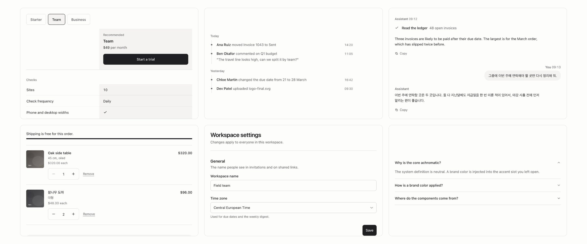

# Taster

English | [한국어](README.ko.md)

[](https://github.com/makim-414/taster/actions/workflows/validate.yml) [](LICENSE) [](#install)

Find the AI slop in a frontend, swap each spot for a pattern that does the same job better, or build a new screen
without it.


[Live site](https://taster-six.vercel.app) | [Watch it live](https://taster-six.vercel.app/demo) | [Components](https://taster-six.vercel.app/components) | [Rules](data/rules/RULES.md) | [Patterns](data/patterns/README.md) | [Guide](docs/guide.md) | [Changelog](CHANGELOG.md)

## <a id="skill"></a>Install

In Claude Code:

```text
/plugin marketplace add makim-414/taster
/plugin install taster@taster
```

One install brings four parts. Codex reads the same plugin from `.codex-plugin/`.

| Part | What it does |
|---|---|
| MCP server | The engine: diagnosis in a real browser, brand, design system, screens and `add` |
| Skill | The rules, the patterns, and which to use when |
| Hooks | Send each edit to the live viewer while an agent works |
| `/taster` | The entry command |

It needs Node.js 22 or later and Google Chrome or Playwright's Chromium. The skill alone runs in any agent that reads
`SKILL.md`:

```bash
npx skills add https://github.com/makim-414/taster --skill taster
```

The command line, the hosted MCP server, the GitHub Action, the extension and every other way in:
[Guide](docs/guide.md).

## What you get

- **Rules.** 88 rules, 85 measured in a real browser by `data/rules/detect.js` and the rest judged by eye from the captures: all caps labels with wide letter spacing, tinted pill badges, thick colored left borders, emoji bullets, Korean text that breaks mid word. A finding says a page shows a trait, not who or what made it ([where the rules come from](#where-the-rules-come-from)).
- **Patterns.** 122 patterns, sorted by what the visitor is trying to do (compare plans, prove trust, label a state) and where (landing, dashboard, store, AI chat and more). Every rule points to the patterns that fix it.
- **Components.** 152 components: token based React components you copy into your app, styled through Tailwind and the Taster preset. No component library to install, no brand to undo.

<picture>
  <source media="(prefers-color-scheme: dark)" srcset=".github/assets/components.dark.jpg">
  <source media="(prefers-color-scheme: light)" srcset=".github/assets/components.light.jpg">
  
</picture>

**[Browse the components](https://taster-six.vercel.app/components).** Every one runs live: click it, recolor it with your
brand or read the brand from your site, and put a few side by side. The hosted pages are in Korean for now; the
sentence the board writes for your agent follows your browser's language.

## What it does

Every session starts with one question: **is this a site that already exists, or are we building a new one?** A URL
or a page file given with it (`/taster https://your-site.example`) answers it: an existing site, diagnosed at once.
The answer picks the route, and every route runs in the same order: Diagnose (an existing site only), then Brand and
references, then the design System made with you, then the Screens, each built from the parts that fit its purpose and
all wearing that system ([SKILL.md](skills/taster/SKILL.md)).

| Route | You give it | You get back |
|---|---|---|
| Existing site, source in your workspace: Diagnose, Brand, System, then Swap | a URL or dev server, and the code | every slop spot outlined on a capture, then the same page with each spot replaced in your code, checked again until clean |
| Existing site, address only: Diagnose, Brand, System, then Rebuild | a URL (a hosted builder, a template, lost source) | the same words, links and brand on a new page made from patterns, checked clean and shown next to the original |
| New site: Brand, System, then Build | a product, an audience, the kind of screen, your real content, your brand and pages you like | a new screen composed from patterns, checked before you see it |

Rebuild and brand absorption are for sites you own or are authorized to rebuild. Brand turns the site's own color,
typeface and logo into a `theme.css` of token overrides, with success and failure colors fitted so they never read as
brand decoration.

More than one screen goes one screen, or one part, at a time: the brand and the tokens become the system first,
then each screen is proposed to the builder, built only after their yes from the components that fit its purpose,
and checked before the next one starts: zero detector findings, and zero drift in `check_consistency`, which renders
every screen and reports the same component drawn differently on two screens and any value that is not one of the
system's tokens. `taster.plan.json` keeps the order and refuses steps out of it
([screens.md](skills/taster/references/screens.md)).

| Before | After |
|---|---|
|  |  |

Before: Acme Ledger, a made-up landing page that breaks 18 of the rules, each finding outlined by Taster. After: the same content rebuilt to the rules, with 0 findings at 1440 and 390 pixels wide. Both pages and the check that proves it are in [`examples/rebuild/`](examples/rebuild/).

`examples/rebuild/` is the worked Rebuild in the pictures above: the generated looking landing page and its
rebuild (0 at both widths, every heading, action and nav item kept, brand color kept), plus a second screen built from
the same components, checked consistent with the first and on the system.
`node packages/engine/scripts/check-rebuild-example.mjs` proves all of it, the rule count under the pictures included.

`examples/icon-slots/` shows five worked variations for each icon slot (control, explanatory, identity, data marker,
no icon), the same 25 that `taxonomy.json` lists. `node packages/engine/scripts/check-icon-slots-example.mjs` checks that the page
matches the taxonomy and has 0 findings at both widths.

## Design system

Before any screen, Taster turns the brand and the builder's intent into one design system. Give it the brand site and
one or two pages whose tone you like. It measures them in a real browser (radii, spacing and control heights, text
contrast, type scale, hues, shadows, motion, borders), places each of the eight axes on a named step, and balances
them against design principles written as constraints, so nothing sits in an ambiguous middle. Move a weight and the
others follow the least needed, with the principle that moved them quoted. The result is `taster.system.json` and a
`theme.css` with every token the axes drive, the brand inside, and text at WCAG AA. Every screen and part loads it.

```bash
node packages/engine/cli.mjs --system https://your-site.example --ref ./a-page-you-like.html --out system
node packages/engine/cli.mjs --tune system/taster.system.json roundness=1
```

MCP tools: `design_system`, `tune_system`, `system_for_category`. How each measurement maps to a step and each step
to tokens: `skills/taster/references/system.md`.

## Privacy

The hosted site (https://taster-six.vercel.app, its hosted MCP server included) has no analytics scripts and sets no
cookies. It does not store the addresses you give it or the results it sends back. When a page cannot be opened, the
error log keeps its host name, not the address. The diagnosis page keeps the address after `#url=`, a part of the link
that browsers do not send, so a reload or a shared link does not put it in a request. The rate limits keep client IP
addresses in server memory, gone when the instance restarts. The first screens the tone map opens (other sites,
opened on request) stay in server memory for up to 30 minutes and are never written to disk. What you pick in the
gallery stays in your browser (`localStorage`). Vercel, which hosts the site, keeps its own request logs under
[its privacy policy](https://vercel.com/legal/privacy-policy).

The local tools, the bookmarklet and the extension send the findings nowhere and have no telemetry. While
`taster watch` runs, the local tools also report each call, and the edit hook each edited file's path, to it, on
127.0.0.1 and to nothing else.

## Taxonomy at a glance

Every category has a one sentence definition, what it includes, what it excludes and where that goes instead, and
generic examples. A decision key over 33 yes or no features gives every UI part exactly one category, first match
wins. The weighting axes drive named properties in `packages/registry/src/tokens.css`, snap to fixed steps so a setting never
sits in an ambiguous middle, and are kept balanced by design principles written as linear constraints (a dense screen
cannot carry poster type, deep shadows need a restrained palette). `data/taxonomy/axes.mjs` validates and balances a
setting. Read [data/taxonomy/SCHEMA.md](data/taxonomy/SCHEMA.md).

<!-- taxonomy:start -->
122 patterns, 88 rules, 152 components, 33 categories in 8 families, 40 uses, 8 surfaces, 8 weighting axes, 10 constraints.

| Family | Categories | Patterns |
|---|---|---|
| Page sections | Hero; Feature and content section; Pricing; Call to action; Testimonial, quote and proof; FAQ | 24 |
| Navigation | Navigation header; Footer; Sidebar; Command palette and shortcuts; Tabs, segmented control and disclosure | 9 |
| Foundations | Layout and shell; Card and list; Typography; Copy and voice; Icon and mark; Theme and tokens | 31 |
| Actions and inputs | Button; Form and input | 9 |
| Feedback and overlays | Badge and label; Toast and alert; Empty and error state; Loader and skeleton; Overlay: dialog, drawer, popover and menu | 13 |
| Data display | Chart and KPI; Table and data grid; Timeline, stepper and calendar; Map | 16 |
| Media, commerce and AI | Media and gallery; Commerce; Chat and AI | 12 |
| Motion and effects | Motion effect and particles; 3D scene | 8 |
<!-- taxonomy:end -->

## Where the rules come from

<!-- rules:start -->
88 rules, 85 measured in a real browser and 3 judged by eye from the captures. Each rule's `basis` in `data/rules/rules.json` says what it rests on: 53 cite outside write-ups about generated pages, 18 a web standard or platform guide, and 49 rest on Taster's own observation, 21 of them on that alone. A rule can rest on more than one.

Outside write-ups cited, most cited first: Signs of AI design; kill-ai-slop; AI Slop Detector by Made with Jev; Impeccable slop catalog; Adrian Krebs, AI design patterns in Show HN pages; taste-skill; Anthropic frontend-design skill; slop-detect; prg.sh, why AI keeps building the same purple gradient; 925 Studios, AI slop design tells; Solo Design, AI design slop tells; Paul Bakaus, Impeccable 3.5 launch post; Hallmark; css-slop-detector.
<!-- rules:end -->

An outside source or a standard is a ref with its link, the date it was read and what it says that backs the rule:
a quote of 15 words or fewer, or one line in Taster's words marked as a summary. A ref that repeats another write-up
names it in `derived_from`. The sources keep their own licenses; Taster links to them and copies neither their text
nor their code. An observation says, in the rule's `observation` field, what Taster saw.
`node packages/engine/scripts/check-rules.mjs` checks every rule's basis and refs.

Hitting a rule does not mean a page was made by AI. The rules that rest on a standard are about screen quality,
whoever made the page, and a page made by hand can hit any of the others too.

## Repository

What each folder holds, the paths that must not move and the generated files: [AGENTS.md](AGENTS.md).

## Develop

Edit sources, then run every gate CI runs, in the same order:

```bash
node scripts/gates.mjs           # all four jobs (npm test runs the same); installs what is missing first
node scripts/gates.mjs browser   # one job: validate, browser, web or action
```

Setup, the gates one by one, the generated files and the rules for code and pictures from elsewhere are in
[CONTRIBUTING.md](CONTRIBUTING.md). Report a vulnerability privately, as [SECURITY.md](SECURITY.md) says.

## Principles

- Measure, then judge. A rule that can be computed from styles is computed, not guessed.
- Fix the token before the component. One accent color, neutral surfaces, hierarchy from size, weight and space.
- Real content over placeholders. No invented numbers, no fake testimonials.
- A clean detector run means the listed tells are gone, not that the design is good. The agent says what it could
  not check.

## License

MIT, see [LICENSE](LICENSE). Third party code in this repository (registry and web) is listed in
[THIRD_PARTY_NOTICES.md](THIRD_PARTY_NOTICES.md).
