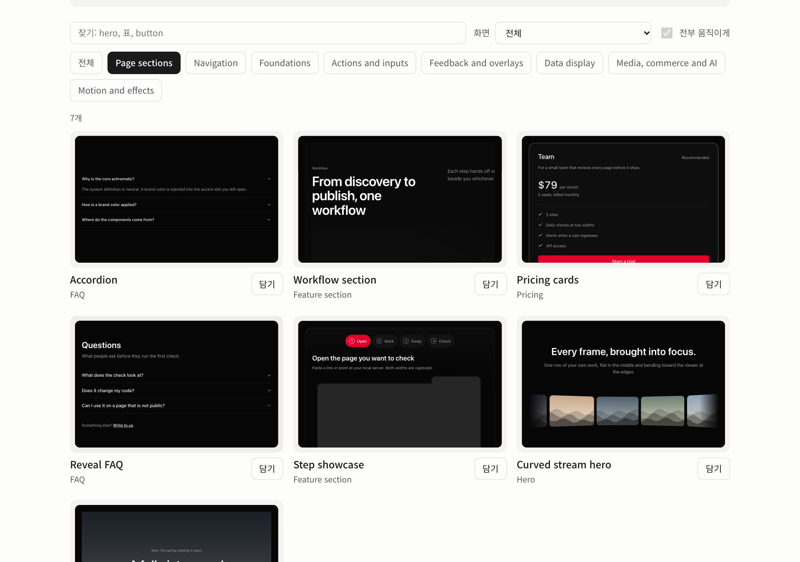
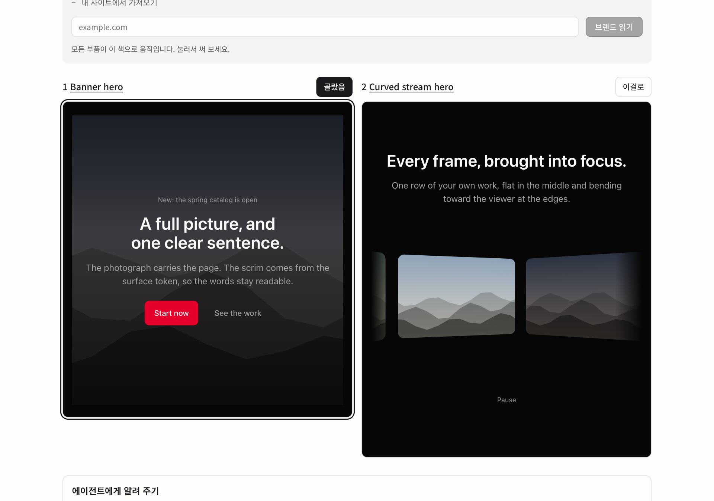

# Taster

Find the AI slop in a frontend, swap each spot for a pattern that does the same job better, or build a new screen
without it.

Taster is a skill and plugin for coding agents (Claude Code, Codex, Cursor and anything that reads `SKILL.md`).
It ships three things the agent uses together:

- **Rules.** Slop tells written down precisely enough to measure: all caps labels with wide letter spacing, tinted
  pill badges, thick colored left borders, emoji bullets, three identical icon cards in a row, Korean text that
  breaks mid word. Most are checked in a real browser by `rules/detect.js`.
- **A taxonomy of patterns.** Reusable design answers organized by what the visitor is trying to do (show one
  number, compare plans, prove trust, label a state) and where (landing, dashboard, app, store, editorial, sign in,
  AI chat). Every rule points to the patterns that fix it.
- **A registry of components.** Token based React components you copy into your app. No package to install, no
  brand to undo.

**[Browse the components](https://taster-six.vercel.app/components).** Every one runs live: click it, recolor it with your
brand or read the brand from your site, and put a few side by side.



## What it does

Every session starts with one question: **is this a site that already exists, or are we building a new one?**
The answer picks the route. Every route also absorbs the brand: the site's own color, typeface and logo become a
`theme.css` of token overrides, with success and failure colors fitted so they never read as brand decoration.

| Route | You give it | You get back |
|---|---|---|
| Existing site, source in your workspace: Diagnose, then Swap | a URL or dev server, and the code | every slop spot outlined on a capture, then the same page with each spot replaced in your code, checked again until clean |
| Existing site, address only: Diagnose, then Rebuild | a URL (a hosted builder, a template, lost source) | the same words, links and brand on a new page made from patterns, checked clean and shown next to the original |
| New site: Build | a product, an audience, the kind of screen, your real content | a new screen composed from patterns, checked before you see it |

`examples/rebuild/` is a worked Rebuild: a generated looking landing page (17 rules hit) and its rebuild (0 at both
widths, every heading, action and nav item kept, brand color kept). `node engine/scripts/check-rebuild-example.mjs`
proves it.

`examples/icon-slots/` shows five worked variations for each icon slot (control, explanatory, identity, data marker,
no icon), the same 25 that `taxonomy.json` lists. `node engine/scripts/check-icon-slots-example.mjs` checks that the page
matches the taxonomy and has 0 findings at both widths.

## Install

Any agent that supports skills:

```bash
npx skills add https://github.com/makim-414/taster --skill taster
```

Claude Code plugin:

```text
/plugin marketplace add makim-414/taster
/plugin install taster@taster
```

Codex: the repository includes `.codex-plugin/plugin.json`.

MCP server (diagnose in a real browser, suggest swaps, fetch patterns and components). The Claude Code plugin
starts it for you. For any other MCP client, clone the repository and point the client at `engine/start.mjs`:

```bash
claude mcp add taster -- node /path/to/taster/engine/start.mjs
```

Command line, no agent needed:

```bash
npm --prefix engine install
node engine/cli.mjs https://example.com --out ./taster-report
node engine/cli.mjs https://example.com --extract    # the page's content, for a rebuild
node engine/cli.mjs https://example.com --brand      # the site's brand as a token theme
```

It uses Playwright's Chromium if installed, otherwise your Google Chrome.

### Add components to your app

```bash
node engine/cli.mjs add blocks/button blocks/citations --dir src/components/taster
```

Copies each component with every file it imports and the token files; no shadcn or other CLI involved. Add
`--from https://taster-six.vercel.app` to read the hosted copy instead of a clone. See `registry/README.md`.

### Choose by eye with your agent

Your agent does not have to pick the look alone. Ask it for a hero or a pricing section and the `browse_components` tool
answers with pictures, a live link for each, and a board link that puts them side by side. `preview_component` shows one
wearing your brand. On the board, press the pick button and paste the sentence it writes back to the agent.

Before the parts, the `pick_tone` tool places the look on a tone map: commerce to brand personality, minimal to
expressive, and an optional genre (geek and developer, editorial and serif, illustration and play, product photo hero,
product screen hero, utility and density). It answers with the nearest real sites, opened on request
and never stored, the eight axes and tokens of that spot, and Taster parts wearing them. The references set the
direction; the parts show what Taster builds. [taster-six.vercel.app/tone](https://taster-six.vercel.app/tone) is the
same map to drag by hand.



### Rules for agents without MCP

`exports/` holds the rules as instruction files for AGENTS.md readers, Claude Code, Cursor, Windsurf, Cline,
GitHub Copilot and Gemini CLI, generated from `rules/rules.json`. `node engine/cli.mjs export all --dir <your app>`
puts each one where its tool reads it and keeps your own text in shared files. See `exports/README.md`.

### Check pull requests (GitHub Action)

```yaml
permissions:
  contents: read
  security-events: write
steps:
  - uses: actions/checkout@v4
  - uses: makim-414/taster@main
    with:
      targets: |
        dist/index.html
        https://staging.example.com/pricing
      fail-on: high
```

It writes the findings to the job summary and as SARIF, uploads the SARIF to code scanning so they show on the
changed files, and fails the step for findings at `fail-on` or worse. Without code scanning, set
`upload-sarif: 'false'`. The CLI does the same locally: `node engine/cli.mjs <targets...> --sarif taster.sarif`.

### Check the page you are looking at (bookmarklet and extension)

[taster-six.vercel.app/bookmarklet](https://taster-six.vercel.app/bookmarklet) has a bookmarklet: drag it to the
bookmarks bar and click it on any page to outline the findings and list the rules hit. For sites that block injected
scripts, load `extension/` as an unpacked extension in Chrome or Edge (it asks only for `activeTab` and `scripting`).

### Use without installing (hosted MCP)

The same MCP server runs at `https://taster-six.vercel.app/api/mcp` (Streamable HTTP). Add it as a remote MCP
server and there is nothing to install:

```bash
claude mcp add --transport http taster https://taster-six.vercel.app/api/mcp
```

In Cursor, `.cursor/mcp.json`: `{ "mcpServers": { "taster": { "url": "https://taster-six.vercel.app/api/mcp" } } }`.
claude.ai and ChatGPT take the same URL as a custom connector. The hosted server leaves out `extract_content`; `diagnose` and
`brand_theme` take public http(s) URLs only and are rate limited per client, `preview_component` answers with a
still and a live link instead of a render, and `pick_tone` opens the references through the same fence and links to the
live parts instead of rendering them. For local files and the full tool set, use the plugin above.

### Use from an editor (ACP)

`engine/acp.mjs` speaks the [Agent Client Protocol](https://agentclientprotocol.com), so editors with an agent
panel can run Taster directly. It has no model inside: it answers slash commands with the engine's results
(`/start`, `/diagnose <url or file>`, `/extract <url>`, `/brand <url>`, `/explain <rule id>`, `/rules`, `/help`).
For swaps and rebuilds, use the skill inside an agent that speaks MCP. Point the editor at
`engine/start.mjs acp`, which installs the engine's dependencies on first start. In Zed's `settings.json`:

```json
{
  "agent_servers": {
    "Taster": {
      "type": "custom",
      "command": "node",
      "args": ["/path/to/taster/engine/start.mjs", "acp"],
      "env": {}
    }
  }
}
```

JetBrains IDEs read the same `agent_servers` shape (without `type`) from `~/.jetbrains/acp.json`; they want the
full path of the executable, so put the output of `which node` in `command`. Other ACP clients (Neovim, Emacs,
and more) take the same command and arguments.

Then type `/taster` in Claude Code (or ask your agent to start Taster). It asks whether your site exists or is new
and takes it from there. You can also ask directly: "Diagnose this site for AI slop", "Rebuild my Lovable site
without the AI look", or "Build a pricing page for this product without generic AI patterns."

## Taxonomy at a glance

<!-- taxonomy:start -->
118 patterns, 74 rules, 65 components, 40 uses, 8 surfaces.

| Family | Categories | Patterns |
|---|---|---|
| Page sections | Hero, Feature section, Pricing, Call to action, Testimonial and proof, FAQ | 24 |
| Navigation | Navigation header, Footer, Sidebar, Command palette, Tabs and segmented control | 7 |
| Foundations | Layout and shell, Card, Typography, Icon and mark | 29 |
| Actions and inputs | Button, Form and input | 9 |
| Feedback and overlays | Badge and label, Toast and alert, Empty and error state, Loader and skeleton, Modal, drawer and menu | 14 |
| Data display | Chart and KPI, Table, Timeline and stepper, Map | 17 |
| Media, commerce and AI | Media and gallery, Commerce, Chat and AI | 12 |
| Motion and effects | Motion and particles, 3D scene | 6 |
<!-- taxonomy:end -->

## Repository

```text
skills/taster/      the skill (SKILL.md, references, and a generated data/ bundle)
taxonomy/            families, categories, uses, surfaces
patterns/            one Markdown file per pattern, plus INDEX.json
rules/               rules.json, detect.js (runs in the page), fixtures and tests
engine/              runs detect.js at two widths: CLI, MCP server (start prompt, diagnose, extract, swap tools), ACP agent, tests
examples/rebuild/    a worked Rebuild, before and after, with its own check
examples/icon-slots/ five variations per icon slot, matched to the taxonomy, with its own check
commands/            the /taster command for Claude Code
registry/            React components (taster add copies them into your app), tokens, a demo page and a render test
scripts/             build-docs.mjs (derives links and the skill bundle), validate.mjs
```

Edit sources, then run:

```bash
node scripts/build-docs.mjs
node scripts/validate.mjs
node rules/test-detect.mjs
npm --prefix engine test
node engine/scripts/check-rebuild-example.mjs
npm --prefix registry run typecheck && node registry/test-render.mjs
```

## Principles

- Measure, then judge. A rule that can be computed from styles is computed, not guessed.
- Fix the token before the component. One accent color, neutral surfaces, hierarchy from size, weight and space.
- Real content over placeholders. No invented numbers, no fake testimonials.
- A clean detector run means the listed tells are gone, not that the design is good. The agent says what it could
  not check.

## License

MIT. Third party code carried in the registry is listed in `registry/THIRD_PARTY_NOTICES.md`.
