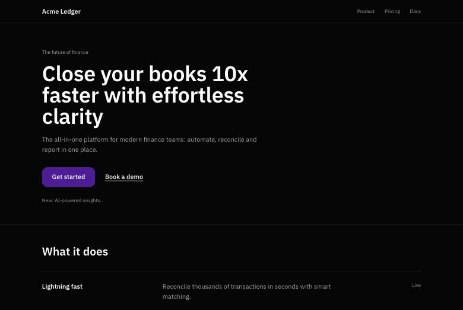
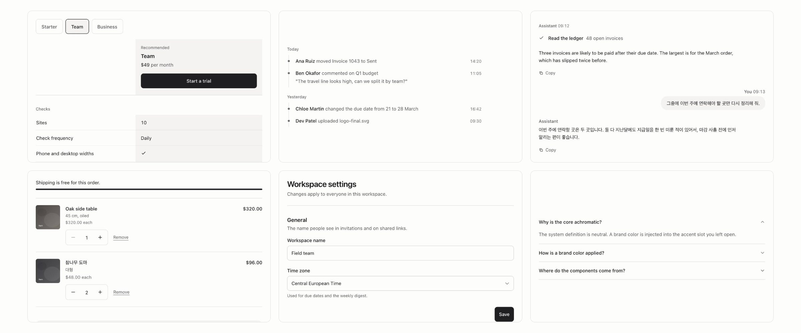

# Taster

English | [한국어](README.ko.md)

Find the AI slop in a frontend, swap each spot for a pattern that does the same job better, or build a new screen without it.

[Live site](https://taster-six.vercel.app) | [Components](https://taster-six.vercel.app/components) | [Rules](data/rules/RULES.md) | [Patterns](data/patterns/README.md) | [Changelog](CHANGELOG.md) | [Contributing](CONTRIBUTING.md)

| Before | After |
|---|---|
|  |  |

Before: Acme Ledger, a made-up landing page that breaks 18 of the rules, each finding outlined by Taster. After: the same content rebuilt to the rules, with 0 findings at 1440 and 390 pixels wide. Both pages and the check that proves it are in [`examples/rebuild/`](examples/rebuild/).

## <a id="skill"></a>Install

```bash
npx skills add https://github.com/makim-414/taster --skill taster
```

The skill works in any agent that reads `SKILL.md`: Claude Code, Codex, Cursor and others.

<a id="claude-code-plugin"></a>In Claude Code, the plugin brings the skill, the `/taster` command and the local MCP server:

```text
/plugin marketplace add makim-414/taster
/plugin install taster@taster
```

The server's first start installs the engine's dependencies, which can take longer than Claude Code waits for a server
to connect; if `taster` shows as failed in `/mcp`, reconnect it there once the install is done.

Requirements, other MCP clients and the first thing to ask: [Install in detail](#install-in-detail). The command line,
source lint, the GitHub Action, the hosted MCP server and the extension: [Use](#use).

## What you get

- **Rules.** 88 rules, 85 measured in a real browser by `data/rules/detect.js` and the rest judged by eye from the captures: all caps labels with wide letter spacing, tinted pill badges, thick colored left borders, emoji bullets, Korean text that breaks mid word. A finding says a page shows a trait, not who or what made it ([where the rules come from](#where-the-rules-come-from)).
- **Patterns.** 122 patterns, sorted by what the visitor is trying to do (compare plans, prove trust, label a state) and where (landing, dashboard, store, AI chat and more). Every rule points to the patterns that fix it.
- **Components.** 144 components: token based React components you copy into your app. No package to install, no brand to undo.

<picture>
  <source media="(prefers-color-scheme: dark)" srcset=".github/assets/components.dark.jpg">
  <source media="(prefers-color-scheme: light)" srcset=".github/assets/components.light.jpg">
  
</picture>

**[Browse the components](https://taster-six.vercel.app/components).** Every one runs live: click it, recolor it with your
brand or read the brand from your site, and put a few side by side. The hosted pages are in Korean for now; the
sentence the board writes for your agent follows your browser's language.

## What it does

Every session starts with one question: **is this a site that already exists, or are we building a new one?**
The answer picks the route, and every route runs in the same order: Diagnose (an existing site only), then Brand and
references, then the design System made with you, then the Screens, each built from the parts that fit its purpose and
all wearing that system ([SKILL.md](skills/taster/SKILL.md)).

| Route | You give it | You get back |
|---|---|---|
| Existing site, source in your workspace: Diagnose, Brand, System, then Swap | a URL or dev server, and the code | every slop spot outlined on a capture, then the same page with each spot replaced in your code, checked again until clean |
| Existing site, address only: Diagnose, Brand, System, then Rebuild | a URL (a hosted builder, a template, lost source) | the same words, links and brand on a new page made from patterns, checked clean and shown next to the original |
| New site: Brand, System, then Build | a product, an audience, the kind of screen, your real content, your brand and pages you like | a new screen composed from patterns, checked before you see it |

Rebuild and brand absorption are for sites you own or are authorized to rebuild. Brand turns the site's own color,
typeface and logo into a `theme.css` of token overrides, with success and failure colors fitted so they never read as
brand decoration.

More than one screen goes one screen, or one part, at a time: the brand and the tokens become the system first,
then each screen is proposed to the builder, built only after their yes from the components that fit its purpose,
and checked before the next one starts: zero detector findings, and zero drift in `check_consistency`, which renders
every screen and reports the same component drawn differently on two screens and any value that is not one of the
system's tokens. `taster.plan.json` keeps the order and refuses steps out of it
([screens.md](skills/taster/references/screens.md)).

`examples/rebuild/` is the worked Rebuild in the pictures at the top: the generated looking landing page and its
rebuild (0 at both widths, every heading, action and nav item kept, brand color kept), plus a second screen built from
the same components, checked consistent with the first and on the system.
`node packages/engine/scripts/check-rebuild-example.mjs` proves all of it, the rule count under the pictures included.

`examples/icon-slots/` shows five worked variations for each icon slot (control, explanatory, identity, data marker,
no icon), the same 25 that `taxonomy.json` lists. `node packages/engine/scripts/check-icon-slots-example.mjs` checks that the page
matches the taxonomy and has 0 findings at both widths.

## Design system

Before any screen, Taster turns the brand and the builder's intent into one design system. Give it the brand site and
one or two pages whose tone you like. It measures them in a real browser (radii, spacing and control heights, text
contrast, type scale, hues, shadows, motion, borders), places each of the eight axes on a named step, and balances
them against design principles written as constraints, so nothing sits in an ambiguous middle. Move a weight and the
others follow the least needed, with the principle that moved them quoted. The result is `taster.system.json` and a
`theme.css` with every token the axes drive, the brand inside, and text at WCAG AA. Every screen and part loads it.

```bash
node packages/engine/cli.mjs --system https://your-site.example --ref ./a-page-you-like.html --out system
node packages/engine/cli.mjs --tune system/taster.system.json roundness=1
```

MCP tools: `design_system`, `tune_system`, `system_for_category`. How each measurement maps to a step and each step
to tokens: `skills/taster/references/system.md`.

## Install in detail

### Requirements

- Node.js 22 or later (the version in `.nvmrc`) and git. The MCP server, the command line and `add` run from a clone
  of this repository; the npm package is not published yet.
- A browser for anything that opens a page: Playwright's Chromium if it is installed, otherwise your Google Chrome.
  `node packages/engine/setup.mjs` in the clone checks for one and downloads Chromium only when neither starts. Source lint
  needs no browser.

### MCP server in other clients

Clone the repository and install the engine once, then point the client at `packages/engine/start.mjs`:

```bash
git clone https://github.com/makim-414/taster.git /path/to/taster
npm ci --prefix /path/to/taster/packages/engine
```

Claude Code without the plugin:

```bash
claude mcp add taster -- node /path/to/taster/packages/engine/start.mjs
```

Codex, in `~/.codex/config.toml` (installed as a Codex plugin, the repository's `.codex-plugin/plugin.json` brings
the skill and this server instead):

```toml
[mcp_servers.taster]
command = "node"
args = ["/path/to/taster/packages/engine/start.mjs"]
```

Cursor, in `.cursor/mcp.json` in your project, or `~/.cursor/mcp.json` for every project:

```json
{ "mcpServers": { "taster": { "command": "node", "args": ["/path/to/taster/packages/engine/start.mjs"] } } }
```

The local server runs with your user's permissions. It opens any http or https address it is given, private ones
included (that is how it checks a dev server), and local `.html`, `.htm`, `.xhtml` and `.svg` files; set
`TASTER_ROOT` to a folder in the server's environment to keep local files inside it. What a page says comes back
inside an `<untrusted_page_content>` block, as data for the agent and never instructions. It writes files only where a
tool is told to and sends nothing anywhere but the pages it opens. The full list is in
[SECURITY.md](SECURITY.md#what-the-local-tools-can-reach).

### Start

Type `/taster` in Claude Code (or ask your agent to start Taster). It asks whether your site exists or is new and
takes it from there. You can also ask directly: "Diagnose this site for AI slop", "Rebuild my site made with an AI
site builder, without the AI look", or "Build a pricing page for this product without generic AI patterns."

## Use

### Command line, no agent needed

In the clone:

```bash
npm ci --prefix packages/engine
node packages/engine/cli.mjs https://example.com --out ./taster-report
node packages/engine/cli.mjs https://example.com --extract    # the page's content, for a rebuild
node packages/engine/cli.mjs https://example.com --brand      # the site's brand as a token theme
```

A page that answers with a bot check, a block or error page, or a sign-in page on another host is reported as not
diagnosed, with no findings and exit code 2. Taster does not get past them.

### Lint the source

The same rules in their source form, for review and CI, no browser needed. The npm package is not published yet, so
clone this repository once and run its CLI from your app folder:

```bash
git clone https://github.com/makim-414/taster.git /path/to/taster   # once
npm ci --prefix /path/to/taster/packages/engine                              # once
node /path/to/taster/packages/engine/cli.mjs lint src                                  # tinted pills, transition-all, hard-coded colors ...
node /path/to/taster/packages/engine/cli.mjs lint src --baseline taster-baseline.json --write-baseline   # adopt on an old codebase
node /path/to/taster/packages/engine/cli.mjs lint src --baseline taster-baseline.json  # then counts may only go down
```

A line passes with a comment `taster-allow <reason>`; an allow without a reason is reported. The npm package will
replace the clone once it is published ([RELEASING.md](RELEASING.md)).

### Add components to your app

From your app folder, with the clone from the step above:

```bash
node /path/to/taster/packages/engine/cli.mjs add blocks/button blocks/citations --dir src/components/taster
```

Copies each component with every file it imports and the token files into `--dir`, relative to the folder you run it
in, with Taster's MIT license next to them; no shadcn or other CLI involved. `--from https://taster-six.vercel.app`
reads the component files from the hosted copy instead of the clone; the command itself still runs from the clone
until the npm release. See [packages/registry/README.md](packages/registry/README.md).

### Choose by eye with your agent

Your agent does not have to pick the look alone. Ask it for a hero or a pricing section and the `browse_components` tool
answers with pictures, a live link for each, and a board link that puts them side by side. `preview_component` shows one
wearing your brand. On the board, press the pick button and paste the sentence it writes back to the agent.

Before the parts, the `pick_tone` tool places the look on a tone map: commerce to brand personality, minimal to
expressive, and an optional genre (geek and developer, editorial and serif, illustration and play, product photo hero,
product screen hero, utility and density). It answers with the nearest real sites, opened on request
(never written to disk, kept in server memory up to 30 minutes; a bot check, a block page or a cookie banner without a
reject button leaves a link only), the eight axes and tokens of that spot, and Taster parts wearing them. The
references set the direction; the parts show what Taster builds.
[taster-six.vercel.app/tone](https://taster-six.vercel.app/tone) is the same map to drag by hand.


### Rules for agents without MCP

`node packages/engine/cli.mjs export all --dir <your app>` writes the rules, from `data/rules/rules.json`, as instruction files for
AGENTS.md readers, Claude Code, Cursor, Windsurf, Cline, GitHub Copilot and Gemini CLI, each where its tool reads it,
and keeps your own text in shared files. Each [release](https://github.com/makim-414/taster/releases) also attaches
the seven files as `taster-exports-<version>.zip`.

### Check pull requests (GitHub Action)

```yaml
permissions:
  contents: read
  security-events: write
steps:
  - uses: actions/checkout@v4
  - uses: makim-414/taster@v0
    with:
      targets: |
        dist/index.html
        https://staging.example.com/pricing
      fail-on: high
```

It writes the findings to the job summary and as SARIF, uploads the SARIF to code scanning so they show on the
changed files, and fails the step for findings at `fail-on` or worse. Without code scanning, set
`upload-sarif: 'false'`. The CLI does the same locally: `node packages/engine/cli.mjs <targets...> --sarif taster.sarif`.
`v0` follows the latest 0.x release; pin a full commit SHA to review each change before it runs in your
workflows.

A target that answers with a bot check, an error or a sign-in page is not diagnosed: the step fails with exit code 2,
and the job summary and the SARIF say why, with no findings. A preview behind deployment protection answers 401 and
lands here. Taster takes no protection bypass token and does not get past sign-in; check the build inside the job
(`dist/index.html` above) or a preview that opens without signing in.

### Check the page you are looking at (bookmarklet and extension)

[taster-six.vercel.app/bookmarklet](https://taster-six.vercel.app/bookmarklet) has a bookmarklet: drag it to the
bookmarks bar and click it on a page to outline the findings and list the rules hit. Each click loads the overlay from
that site, but the bookmark holds the overlay's sha384 and the overlay holds those of the detector and the rule names,
so it runs only the files it was made with; once the site has newer ones, it stops and asks you to get the bookmarklet
again. None of these requests sends a Referer, and the findings go nowhere. The scripts still run inside the page with
its permissions, so on banking or admin screens use the extension. A bookmarklet saved before these pinned files
loads `/taster/overlay.js`, runs whatever the site serves there, and sends that first request with a Referer: drag
the bookmarklet from `/bookmarklet` again.

For those screens, and for sites that block injected scripts, load `apps/extension/` as an unpacked extension in Chrome or
Edge. It carries the same files inside, asks only for `activeTab` and `scripting`, and runs only when you press its
button.

### Use without installing (hosted MCP)

The same MCP server runs at `https://taster-six.vercel.app/api/mcp` (Streamable HTTP). Add it as a remote MCP
server and there is nothing to install:

```bash
claude mcp add --transport http taster https://taster-six.vercel.app/api/mcp
```

In Cursor, `.cursor/mcp.json`: `{ "mcpServers": { "taster": { "url": "https://taster-six.vercel.app/api/mcp" } } }`.
claude.ai and ChatGPT take the same URL as a custom connector. The hosted server leaves out `extract_content`, the
design system tools and the screen by screen tools. `diagnose` and `brand_theme` take public http(s) URLs only,
`preview_component` answers with a still and a live link instead of a render, and `pick_tone` opens the references
through the same fence and links to the live parts instead of rendering them. Every tool call counts against a per
client limit that each server instance keeps on its own. A request carries one JSON-RPC message (a batch is refused),
and an answer over 4 MB comes back as an error instead. For local files and the full tool set, use the plugin above.

### Use from an editor (ACP)

`packages/engine/acp.mjs` speaks the [Agent Client Protocol](https://agentclientprotocol.com), so editors with an agent
panel can run Taster directly. It has no model inside: it answers slash commands with the engine's results
(`/start`, `/diagnose <url or file>`, `/extract <url>`, `/brand <url>`, `/explain <rule id>`, `/rules`, `/help`).
For swaps and rebuilds, use the skill inside an agent that speaks MCP. Point the editor at
`packages/engine/start.mjs acp`, which installs the engine's dependencies on first start. In Zed's `settings.json`:

```json
{
  "agent_servers": {
    "Taster": {
      "type": "custom",
      "command": "node",
      "args": ["/path/to/taster/packages/engine/start.mjs", "acp"],
      "env": {}
    }
  }
}
```

JetBrains IDEs read the same `agent_servers` shape (without `type`) from `~/.jetbrains/acp.json`; they want the
full path of the executable, so put the output of `which node` in `command`. Other ACP clients (Neovim, Emacs,
and more) take the same command and arguments.

## Privacy

The hosted site (https://taster-six.vercel.app, its hosted MCP server included) has no analytics scripts and sets no
cookies. It does not store the addresses you give it or the results it sends back. When a page cannot be opened, the
error log keeps its host name, not the address. The diagnosis page keeps the address after `#url=`, a part of the link
that browsers do not send, so a reload or a shared link does not put it in a request. The rate limits keep client IP
addresses in server memory, gone when the instance restarts. The first screens the tone map opens (other sites,
opened on request) stay in server memory for up to 30 minutes and are never written to disk. What you pick in the
gallery stays in your browser (`localStorage`). Vercel, which hosts the site, keeps its own request logs under
[its privacy policy](https://vercel.com/legal/privacy-policy).

The local tools, the bookmarklet and the extension send the findings nowhere and have no telemetry.

## Taxonomy at a glance

Every category has a one sentence definition, what it includes, what it excludes and where that goes instead, and
generic examples. A decision key over 33 yes or no features gives every UI part exactly one category, first match
wins. The weighting axes drive named properties in `packages/registry/src/tokens.css`, snap to fixed steps so a setting never
sits in an ambiguous middle, and are kept balanced by design principles written as linear constraints (a dense screen
cannot carry poster type, deep shadows need a restrained palette). `data/taxonomy/axes.mjs` validates and balances a
setting. Read [data/taxonomy/SCHEMA.md](data/taxonomy/SCHEMA.md).

<!-- taxonomy:start -->
122 patterns, 88 rules, 144 components, 33 categories in 8 families, 40 uses, 8 surfaces, 8 weighting axes, 10 constraints.

| Family | Categories | Patterns |
|---|---|---|
| Page sections | Hero; Feature and content section; Pricing; Call to action; Testimonial, quote and proof; FAQ | 24 |
| Navigation | Navigation header; Footer; Sidebar; Command palette and shortcuts; Tabs, segmented control and disclosure | 9 |
| Foundations | Layout and shell; Card and list; Typography; Copy and voice; Icon and mark; Theme and tokens | 31 |
| Actions and inputs | Button; Form and input | 9 |
| Feedback and overlays | Badge and label; Toast and alert; Empty and error state; Loader and skeleton; Overlay: dialog, drawer, popover and menu | 13 |
| Data display | Chart and KPI; Table and data grid; Timeline, stepper and calendar; Map | 16 |
| Media, commerce and AI | Media and gallery; Commerce; Chat and AI | 12 |
| Motion and effects | Motion effect and particles; 3D scene | 8 |
<!-- taxonomy:end -->

## Where the rules come from

<!-- rules:start -->
88 rules, 85 measured in a real browser and 3 judged by eye from the captures. Each rule's `basis` in `data/rules/rules.json` says what it rests on: 53 cite outside write-ups about generated pages, 18 a web standard or platform guide, and 49 rest on Taster's own observation, 21 of them on that alone. A rule can rest on more than one.

Outside write-ups cited, most cited first: Signs of AI design; kill-ai-slop; AI Slop Detector by Made with Jev; Impeccable slop catalog; Adrian Krebs, AI design patterns in Show HN pages; taste-skill; Anthropic frontend-design skill; slop-detect; prg.sh, why AI keeps building the same purple gradient; 925 Studios, AI slop design tells; Solo Design, AI design slop tells; Paul Bakaus, Impeccable 3.5 launch post; Hallmark; css-slop-detector.
<!-- rules:end -->

An outside source or a standard is a ref with its link, the date it was read and what it says that backs the rule:
a quote of 15 words or fewer, or one line in Taster's words marked as a summary. A ref that repeats another write-up
names it in `derived_from`. The sources keep their own licenses; Taster links to them and copies neither their text
nor their code. An observation says, in the rule's `observation` field, what Taster saw.
`node packages/engine/scripts/check-rules.mjs` checks every rule's basis and refs.

Hitting a rule does not mean a page was made by AI. The rules that rest on a standard are about screen quality,
whoever made the page, and a page made by hand can hit any of the others too.

## Repository

What each folder holds, the paths that must not move and the generated files: [AGENTS.md](AGENTS.md).

## Develop

Edit sources, then run every gate CI runs, in the same order:

```bash
node scripts/gates.mjs           # all four jobs (npm test runs the same); installs what is missing first
node scripts/gates.mjs browser   # one job: validate, browser, web or action
```

Setup, the gates one by one, the generated files and the rules for code and pictures from elsewhere are in
[CONTRIBUTING.md](CONTRIBUTING.md). Report a vulnerability privately, as [SECURITY.md](SECURITY.md) says.

## Principles

- Measure, then judge. A rule that can be computed from styles is computed, not guessed.
- Fix the token before the component. One accent color, neutral surfaces, hierarchy from size, weight and space.
- Real content over placeholders. No invented numbers, no fake testimonials.
- A clean detector run means the listed tells are gone, not that the design is good. The agent says what it could
  not check.

## License

MIT, see [LICENSE](LICENSE). Third party code in this repository (registry and web) is listed in
[THIRD_PARTY_NOTICES.md](THIRD_PARTY_NOTICES.md).
