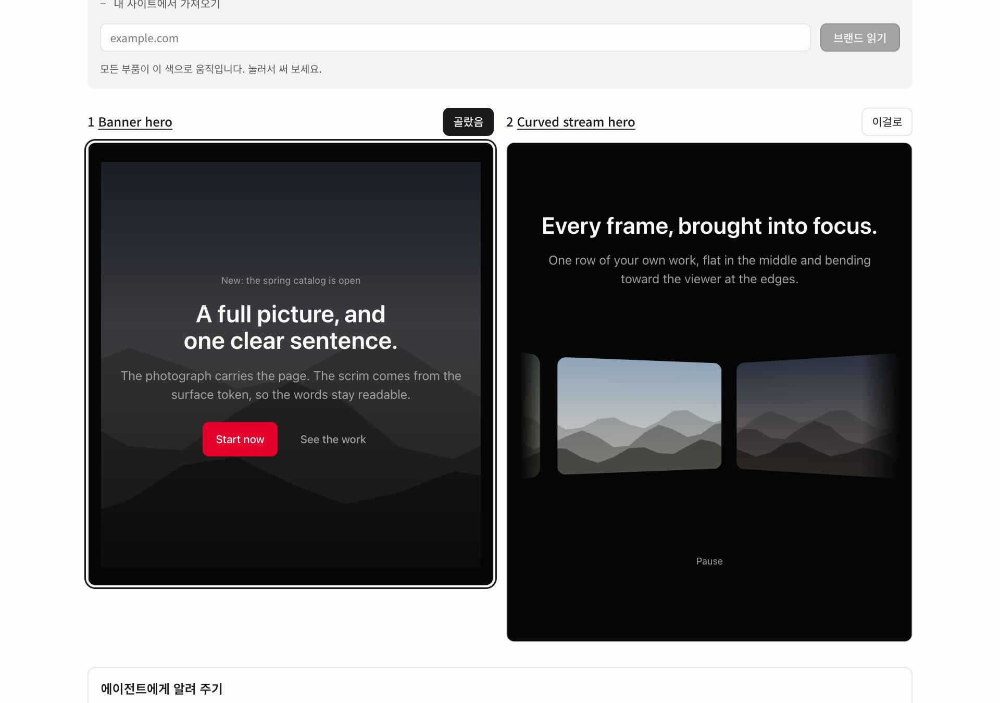

# 안내서

[README](../README.ko.md) | [English](guide.md) | 한국어

## 설치

<a id="claude-code-플러그인"></a>**Claude Code 플러그인: 한 번에 전부.** 스킬, `/taster` 진입점, 로컬 MCP 서버를
한 번에 넣습니다. MCP 서버가 엔진입니다. 실제 브라우저에서 하는 진단, 브랜드, 디자인 시스템, 화면을 맡습니다.
Claude Code 가 보는 `PATH` 에 Node.js 22 이상이 있어야 하고, Google Chrome 이나 Playwright 의 Chromium 이 필요합니다.

```text
/plugin marketplace add makim-414/taster
/plugin install taster@taster
```

터미널에서는 이렇게 합니다.

```bash
claude plugin marketplace add makim-414/taster
claude plugin install taster@taster
```

서버를 처음 켤 때 엔진 의존성을 설치하는데, Claude Code 가 서버 연결을 기다리는 시간보다 길어질 수 있습니다.
`/mcp` 에서 `taster` 가 실패로 보이면 설치가 끝난 뒤 그 화면에서 다시 연결하세요. 이 리포 맨 위의 `.claude-plugin/`,
`.codex-plugin/`, `.mcp.json` 은 Claude Code 와 Codex 가 플러그인을 설치할 때 읽는 플러그인 자체의 파일이고, 기여자용
개발 설정이 아닙니다.

**스킬만: 규칙과 패턴, 어느 에이전트에서나.**

```bash
npx skills add https://github.com/makim-414/taster --skill taster
```

`SKILL.md` 를 읽는 모든 에이전트(Claude Code, Codex, Cursor 등)에서 돌고, 규칙, 패턴, 페이지 안에서 도는 검사기
(`data/detect.js`)를 줍니다. 검사기는 에이전트의 브라우저 도구로 실행합니다. 엔진은 위의 플러그인,
[원격 MCP 서버](#설치-없이-쓰기-원격-mcp)(공개 주소의 진단과 브랜드. 디자인 시스템과 화면 도구는 없음), 또는 클론에서 옵니다.

**클론: 명령줄, 소스 린트, `add`, 다른 클라이언트의 MCP 서버.** Node.js 22 이상과 git, 페이지를 여는 기능에는 Google
Chrome 이나 Playwright 의 Chromium 이 필요합니다. [자세한 설치](#자세한-설치) 에 있습니다.

처음 할 말은 [시작](#시작) 에 있습니다. 명령줄, 소스 린트, GitHub Action, 원격 MCP 서버, 확장은 [쓰기](#쓰기) 에
있습니다.

## 자세한 설치

### 필요한 것

- Node.js 22 이상(`.nvmrc` 의 버전)과 git. 플러그인 밖에서는 MCP 서버, 명령줄, `add` 를 이 리포를 받은 클론에서
  실행합니다. npm 패키지는 아직 게시 전입니다.
- 페이지를 여는 기능에는 브라우저가 필요합니다. Playwright 의 Chromium 이 있으면 그것을, 없으면 설치된 Google
  Chrome 을 씁니다. 클론에서 `node packages/engine/setup.mjs` 를 실행하면 둘 중 하나가 뜨는지 확인하고, 둘 다 안 될 때만
  Chromium 을 받습니다. 소스 린트에는 브라우저가 필요 없습니다.

### 다른 클라이언트에서 MCP 서버 쓰기

리포를 받아 엔진을 한 번 설치한 뒤, 클라이언트에 `packages/engine/start.mjs` 를 연결합니다.

```bash
git clone https://github.com/makim-414/taster.git /path/to/taster
npm ci --prefix /path/to/taster/packages/engine
```

플러그인 없이 Claude Code:

```bash
claude mcp add taster -- node /path/to/taster/packages/engine/start.mjs
```

Codex 는 `~/.codex/config.toml` 에 넣습니다(리포를 Codex 플러그인으로 설치하면 `.codex-plugin/plugin.json` 이 스킬과
이 서버를 함께 넣습니다).

```toml
[mcp_servers.taster]
command = "node"
args = ["/path/to/taster/packages/engine/start.mjs"]
```

Cursor 는 프로젝트의 `.cursor/mcp.json`, 모든 프로젝트에 쓰려면 `~/.cursor/mcp.json` 에 넣습니다.

```json
{ "mcpServers": { "taster": { "command": "node", "args": ["/path/to/taster/packages/engine/start.mjs"] } } }
```

로컬 서버는 내 사용자 권한으로 돕니다. 받은 http, https 주소는 사설 주소까지 모두 열고(그래서 개발 서버를 잴 수
있습니다), 로컬 파일은 `.html`, `.htm`, `.xhtml`, `.svg` 만 엽니다. 서버 환경 변수 `TASTER_ROOT` 에 폴더를 주면
로컬 파일을 그 폴더 안에서만 엽니다. 페이지가 담은 글은 `<untrusted_page_content>` 블록 안에 담아 돌려주며,
에이전트가 읽을 데이터일 뿐 따를 지시가 아닙니다. 파일은 도구에 지정한 곳에만 쓰고, 연 페이지 말고는 어디로도 보내지
않습니다. 자세한 목록은 [SECURITY.md](../SECURITY.md#what-the-local-tools-can-reach) 에 있습니다.

### 시작

Claude Code 에서 `/taster` 를 치면(또는 에이전트에게 "Taster 시작해줘") 이미 있는 사이트인지 새로 지을지부터
묻고 이어 갑니다. `/taster https://내-사이트` 처럼 주소나 페이지 파일을 함께 주면 묻지 않고 바로 진단합니다. 바로 말해도 됩니다. "이 사이트 슬롭 진단해줘", "AI 사이트 빌더로 만든 내 사이트 AI 티 안 나게
다시 지어줘", "이 제품 요금제 페이지를 AI 티 안 나게 만들어줘".

## 쓰기

### 명령줄 (에이전트 없이)

클론에서:

```bash
npm ci --prefix packages/engine
node packages/engine/cli.mjs https://example.com --out ./taster-report
node packages/engine/cli.mjs https://example.com --extract    # 다시 짓기에 쓸 페이지 내용
node packages/engine/cli.mjs https://example.com --brand      # 사이트 브랜드를 토큰 테마로
```

봇 확인, 차단·오류 화면, 다른 호스트의 로그인 화면이 돌아오면 진단하지 않았다고 알리고 발견은 내놓지 않습니다(종료
코드 2). Taster 는 그런 화면을 우회하지 않습니다.

### 소스 린트

같은 규칙의 소스 코드 형태입니다. 리뷰와 CI 에 쓰고, 브라우저가 필요 없습니다. npm 패키지는 아직 게시 전이라 이
리포를 한 번 받아 두고 내 앱 폴더에서 그 CLI 를 실행합니다.

```bash
git clone https://github.com/makim-414/taster.git /path/to/taster   # 한 번만
npm ci --prefix /path/to/taster/packages/engine                              # 한 번만
node /path/to/taster/packages/engine/cli.mjs lint src                                  # 옅은 알약, transition-all, 하드코딩 색 ...
node /path/to/taster/packages/engine/cli.mjs lint src --baseline taster-baseline.json --write-baseline   # 오래된 코드에 처음 도입
node /path/to/taster/packages/engine/cli.mjs lint src --baseline taster-baseline.json  # 그 뒤로는 개수가 줄기만 해야 함
```

`taster-allow <이유>` 주석을 단 줄은 통과하고, 이유 없는 허용은 따로 보고합니다. npm 패키지가 게시되면 클론 대신
그것을 씁니다([RELEASING.md](../RELEASING.md)).

### 내 앱에 부품 넣기

부품은 Tailwind 클래스로 그리고, Taster 프리셋이 그 클래스를 토큰에 연결합니다. 그래서 내 앱에 Tailwind CSS(v3 또는
v4)와 이 프리셋이 있어야 합니다. 없으면 빌드는 통과하는데 부품이 스타일 없이 나옵니다.

내 앱 폴더에서, 위 단계의 클론으로:

```bash
node /path/to/taster/packages/engine/cli.mjs add blocks/button blocks/citations --dir src/components/taster
```

부품마다 그 부품이 import 하는 파일과 토큰 파일을 함께, 명령을 실행한 폴더 기준 `--dir` 아래로 복사하고, Taster 의
MIT 라이선스도 옆에 둡니다. shadcn 같은 다른 CLI 는 필요 없습니다. `--from https://taster-six.vercel.app` 를 붙이면
부품 파일을 클론 대신 호스팅 사본에서 읽지만, npm 게시 전까지 명령 자체는 클론에서 실행합니다. 자세한 내용은
[packages/registry/README.md](../packages/registry/README.md).

그다음 `src/components/taster/tokens.css` 를 앱 루트에서 한 번 import 하고 Tailwind 에 프리셋을 줍니다. 설정 파일은 앱
루트에 두고, `package.json` 에 `"type": "module"` 이 있는 앱에서도 `require` 가 되도록 이름을 `.cjs` 로 합니다.

```js
// tailwind.config.cjs
module.exports = {
  presets: [require('./src/components/taster/tailwind-preset.cjs')],
  content: ['./index.html', './src/**/*.{ts,tsx}'],
};
```

Tailwind v3 는 이 파일을 그대로 읽습니다. Tailwind v4 는 `@config` 로 읽습니다. Tailwind 를 불러오는 `src/` 의
스타일시트(예: `src/index.css`) 맨 위에 넣습니다.

```css
@import "tailwindcss";
@config "../tailwind.config.cjs";
```

`tokens.css` 는 `:root` 에 `--bg`, `--text`, `--border`, `--accent` 등을 정의합니다. 내 앱의 스타일시트가 같은 이름을
정의하고 그 뒤에 불러오면 그쪽이 이기고, 부품이 그 색을 씁니다. 새로 만든 Vite 앱의 스타터 CSS 가 바로 그렇습니다.
스타터 CSS 에서 그 변수들을 지우거나 이름을 바꾸세요.

이미 자기 Tailwind 테마가 있는 앱(v4 `@theme`, 또는 v3 설정의 colors)에는 `tokens.css` 와 프리셋을 넣지 않습니다.
`--accent`, `rounded-lg` 같은 이름을 다시 정의해 앱 모습이 바뀌기 때문입니다. 대신 `add` 가 부품 클래스를 앱의 토큰으로
옮기고(`bg-accent` 는 `bg-brand`, `text-text-muted` 는 `text-ink-muted`, `text-h2` 는 `text-2xl`), 나머지는 `tst-`
접두사로 묶어 생성한 `taster.css` 한 파일에 정의하며, 옮긴 내역과 추가할 한 줄을 출력합니다
([packages/registry/README.md](../packages/registry/README.md#an-app-with-its-own-theme)).

### 에이전트와 함께 눈으로 고르기

모양을 에이전트 혼자 고르지 않아도 됩니다. "히어로 보여줘"라고 하면 `browse_components` 도구가 그림, 부품별 실행 링크,
나란히 비교 링크를 돌려줍니다. `preview_component` 는 부품 하나에 내 브랜드를 입혀 보여 줍니다. 비교 화면에서 고르기
단추를 누르면 에이전트에게 붙여 넣을 글이 나옵니다.

부품보다 먼저 톤을 정할 수도 있습니다. `pick_tone` 도구는 상업성과 브랜드 개성, 미니멀과 화려 사이의 한 점(결을 고르면
그 결 안에서)을 받아(결: 긱·개발자, 에디토리얼·세리프, 일러스트·장난, 제품 사진 히어로, 제품 화면 히어로, 실용·밀도),
가까운 실제 사이트의 첫 화면(요청할 때 열고, 디스크에 쓰지 않으며 서버 메모리에만 최대 30분. 봇 확인, 차단 화면, 거부
단추가 없는 쿠키 창은 링크만), 그 위치의 8개 축과 토큰, 그 토큰을 입은 Taster 부품을 보여 줍니다. 레퍼런스는 방향이고,
부품이 실제로 받게 될 화면입니다. [톤 고르기](https://taster-six.vercel.app/tone) 화면에서 직접 점을 옮겨 볼 수 있습니다.



### MCP 없는 에이전트용 규칙 파일

`node packages/engine/cli.mjs export all --dir <내 앱>` 은 규칙을 AGENTS.md, Claude Code, Cursor, Windsurf, Cline, GitHub Copilot,
Gemini CLI 용 지침 파일로 만들어(`data/rules/rules.json` 에서 생성) 각 도구가 읽는 자리에 넣고, 같이 쓰는 파일에서는 내 글을
그대로 둡니다. [릴리스](https://github.com/makim-414/taster/releases)마다 같은 파일 7개를 `taster-exports-<버전>.zip` 으로도
붙입니다.

### PR 검사 (GitHub Action)

```yaml
permissions:
  contents: read
  security-events: write
steps:
  - uses: actions/checkout@v4
  - uses: makim-414/taster@v0
    with:
      targets: |
        dist/index.html
        https://staging.example.com/pricing
      fail-on: high
```

결과를 작업 요약과 SARIF 로 남기고, SARIF 를 코드 스캔에 올려 바뀐 파일 위에 표시하며, `fail-on`(기본 high) 이상이면
단계를 실패시킵니다. 코드 스캔이 없으면 `upload-sarif: 'false'`. 로컬에서는 `node packages/engine/cli.mjs <대상...> --sarif taster.sarif`.
`v0` 은 가장 최근 0.x 릴리스를 따릅니다. 바뀐 내용을 하나하나 보고 쓰려면 커밋 SHA 전체로 고정하세요.

봇 확인, 오류 화면, 로그인 화면이 돌아온 대상은 진단하지 않습니다. 단계는 종료 코드 2 로 실패하고, 작업 요약과
SARIF 에 이유를 적으며 발견은 없습니다. 배포 보호가 켜진 프리뷰는 401 을 돌려주므로 여기에 해당합니다. Taster 는
보호 우회 토큰을 받지 않고 로그인을 넘지 않습니다. 작업 안에서 만든 빌드(위의 `dist/index.html`)나 로그인 없이
열리는 프리뷰를 재세요.

### 보고 있는 페이지 재기 (북마클릿과 확장)

[taster-six.vercel.app/bookmarklet](https://taster-six.vercel.app/bookmarklet) 의 북마클릿을 북마크 막대로 끌어 두고
재고 싶은 페이지에서 누르면, 걸린 곳에 테두리를 치고 규칙 목록을 띄웁니다. 누를 때마다 그 사이트에서 오버레이를 받지만,
북마크가 오버레이의 sha384 를, 오버레이가 검사기와 규칙 이름 파일의 sha384 를 들고 있어서 만든 때의 파일만 실행합니다.
사이트의 파일이 새것으로 바뀌면 실행하지 않고 북마클릿을 다시 받으라고 알립니다. 이 요청들은 Referer 를 보내지 않고,
측정 결과는 어디로도 보내지 않습니다. 스크립트는 그 페이지 안에서 그 페이지 권한으로 돌므로 은행·관리자 화면에서는
확장을 쓰세요. 고정 파일 이전에 저장한 북마클릿은 `/taster/overlay.js` 를 받아 그 사이트가 지금 주는 것을 실행하고,
그 첫 요청에는 Referer 가 붙습니다. `/bookmarklet` 에서 북마클릿을 다시 끌어 두세요.

그런 화면이나 외부 스크립트를 막는 사이트에서는 `apps/extension/` 폴더를 크롬이나 엣지에 압축해제 확장으로 불러오세요.
같은 파일을 확장 안에 들고 있고, `activeTab`, `scripting` 권한만 쓰며, 단추를 누른 때만 동작합니다.

### 설치 없이 쓰기 (원격 MCP)

같은 MCP 서버가 `https://taster-six.vercel.app/api/mcp` 에서 돌아갑니다(Streamable HTTP). 원격 MCP 서버로 넣으면
설치할 것이 없습니다.

```bash
claude mcp add --transport http taster https://taster-six.vercel.app/api/mcp
```

Cursor 는 `.cursor/mcp.json` 에 `{ "mcpServers": { "taster": { "url": "https://taster-six.vercel.app/api/mcp" } } }`.
claude.ai 와 ChatGPT 는 같은 주소를 사용자 지정 커넥터로 넣습니다. 원격 서버에는 `get_findings`, `extract_content`, 디자인 시스템
도구, 화면 단위 도구가 없습니다. `diagnose` 와 `brand_theme` 는 공개 http(s) 주소만 받고, `preview_component` 는 그리는
대신 정지 화면과 실행 링크를 돌려주며, `pick_tone` 은 같은 울타리를 거쳐 레퍼런스를 열고 부품은 그리는 대신 실행
링크로 줍니다. 모든 도구 호출은 사용자별 한도에 들어가고, 이 한도는 서버 인스턴스마다 따로 셉니다. 요청 하나에는
JSON-RPC 메시지 하나만 받고(묶음은 거부), 4 MB 를 넘는 답은 오류로 바꿔 돌려줍니다. 로컬 파일과 전체 도구는 위의
플러그인으로 쓰세요.

### 에디터에서 쓰기 (ACP)

`packages/engine/acp.mjs` 는 [Agent Client Protocol](https://agentclientprotocol.com) 을 말하므로 에이전트 패널이 있는
에디터에서 Taster 를 바로 돌릴 수 있습니다. 안에 모델은 없고 슬래시 명령에 엔진 결과로 답합니다(`/start [주소나 파일]`,
`/taster` 도 같음, `/diagnose <주소나 파일>`, `/extract <주소>`, `/brand <주소>`, `/explain <규칙 id>`, `/rules`, `/help`). 교체나
다시 짓기는 MCP 를 쓰는 에이전트 안에서 스킬로 하세요. 에디터에는 `packages/engine/start.mjs acp` 를 넣으면 됩니다. 처음
켤 때 엔진 의존성을 알아서 설치합니다. Zed 의 `settings.json` 에는 이렇게 넣습니다.

```json
{
  "agent_servers": {
    "Taster": {
      "type": "custom",
      "command": "node",
      "args": ["/path/to/taster/packages/engine/start.mjs", "acp"],
      "env": {}
    }
  }
}
```

JetBrains IDE 는 같은 `agent_servers` 모양(`type` 없이)을 `~/.jetbrains/acp.json` 에서 읽습니다. 실행 파일의 전체
경로를 원하므로 `command` 에는 `which node` 결과를 넣으세요. 다른 ACP 클라이언트(Neovim, Emacs 등)도 같은 명령과
인자를 넣으면 됩니다.

### 에이전트가 일하는 모습 보기 (라이브 뷰어)

`taster watch` 는 에이전트가 Taster 로 하는 일을 하는 동안 그려 주는 로컬 페이지를 띄웁니다. 터미널을 하나 더 열고
클론에서:

```bash
node packages/engine/taster.mjs watch     # http://127.0.0.1:47474/#k=<키> 를 찍어 줍니다. --port 0 은 빈 포트
```

찍힌 주소를 브라우저에서 엽니다. 그다음부터 같은 사용자로 돌린 Taster 호출(Claude Code, Codex, Cursor 의 로컬 MCP
서버, ACP 에디터, 명령줄)이 일어나는 대로 보입니다. 진단 하나마다 페이지의 깨끗한 사진이 무대에 올라가고 발견 하나하나가
실제 위치에 표시됩니다. 에이전트마다 제 색의 커서가 발견, 바꿔 넣는 부품, 조정하는 토큰, 기록하는 계획 단계로 날아갑니다.
부품을 넣거나 토큰을 조정하거나 계획 검사를 기록하면 허브가 로컬 페이지(파일이나 localhost 서버)를 바뀔 때까지 다시
열고, 규칙이 사라진 표시는 해결로 바뀝니다. 플러그인으로 설치했다면 설치된 사본의 `node packages/engine/start.mjs watch`
가 같은 일을 합니다.

에이전트가 소스를 고치는 동안에는 페이지가 수정 하나마다 바뀝니다. 플러그인은 Claude Code 훅을 하나 더하는데, Edit,
Write, MultiEdit 가 끝날 때마다 어느 파일이 바뀌었는지 허브에 알립니다(다른 에이전트는
`node packages/engine/taster.mjs live edit --file <경로> --client <이름>` 을 직접 부르고, `add` 는 쓴 파일을 알립니다).
허브는 개발 서버가 다시 읽어 들인 뒤 로컬 페이지를 다시 열어 요소를 직전 것과 비교하고, 바뀐 영역을 보냅니다. 고친
에이전트의 커서가 영역마다 날아가 크기와 함께 상자를 그리고, 그 영역만 새 사진으로 바뀝니다. 사라진 발견은 그 자리에서
해결로 바뀌어 수가 수정 하나마다 줄어듭니다. 영역은 다시 읽기 전후의 페이지를 비교해 찾은 것이지 수정을 요소까지 따라간
것이 아닙니다. 공용 스타일시트를 고치면 그것이 바꾼 모든 곳이 영역으로 나오고, 두 번 읽는 사이에 겹친 수정은 파일 이름으로
영역에 짝지어집니다. `taster watch` 가 돌지 않으면 훅은 아무것도 하지 않고 바로 끝납니다.

검사기는 페이지를 한 번에 재므로 발견은 한꺼번에 도착합니다. 커서가 들르는 순서는 뷰어가 실제 위치를 보고 정한 것입니다.
심각한 것부터 30개를 위에서 아래로 들르고, 나머지는 표시만 합니다. 뷰어 화면에도 그렇게 적혀 있습니다. `taster watch` 가
돌지 않을 때는 아무것도 보내지 않고, 허브는 127.0.0.1 에서만 듣습니다([SECURITY.md](../SECURITY.md#live-viewer-taster-watch)).
