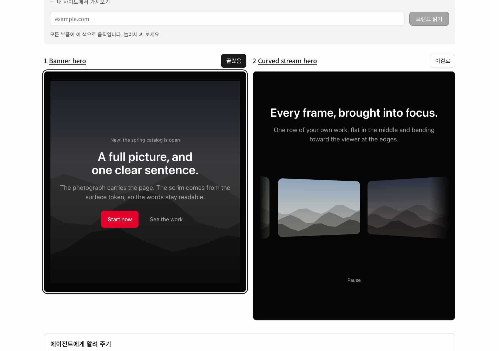

# Guide

[README](../README.md) | English | [한국어](guide.ko.md)

## Install

<a id="claude-code-plugin"></a>**Claude Code plugin: everything in one step.** It installs the skill, the `/taster`
entry and the local MCP server, which is the engine: diagnosis in a real browser, brand, design system and screens.
It needs Node.js 22 or later on the `PATH` Claude Code sees, and Google Chrome or Playwright's Chromium.

```text
/plugin marketplace add makim-414/taster
/plugin install taster@taster
```

The same from a terminal:

```bash
claude plugin marketplace add makim-414/taster
claude plugin install taster@taster
```

The server's first start installs the engine's dependencies, which can take longer than Claude Code waits for a server
to connect; if `taster` shows as failed in `/mcp`, reconnect it there once the install is done. `.claude-plugin/`,
`.codex-plugin/` and `.mcp.json` at the root of this repository are the plugin's own files, read when Claude Code or
Codex installs it, not a development setup for contributors.

**The skill alone: the rules and patterns, in any agent.**

```bash
npx skills add https://github.com/makim-414/taster --skill taster
```

It works in any agent that reads `SKILL.md` (Claude Code, Codex, Cursor and others) and gives it the rules, the
patterns and the in-page detector (`data/detect.js`) to run with the agent's own browser tool. The engine comes from
the plugin above, the [hosted MCP server](#use-without-installing-hosted-mcp) (diagnosis and brand on public
addresses, without the design system and screen tools) or a clone.

**A clone: the command line, source lint, `add` and the MCP server in other clients.** It needs Node.js 22 or later
and git, and Google Chrome or Playwright's Chromium for anything that opens a page:
[Install in detail](#install-in-detail).

The first thing to ask: [Start](#start). The command line, source lint, the GitHub Action, the hosted MCP server and
the extension: [Use](#use).

## Install in detail

### Requirements

- Node.js 22 or later (the version in `.nvmrc`) and git. Outside the plugin, the MCP server, the command line and
  `add` run from a clone of this repository; the npm package is not published yet.
- A browser for anything that opens a page: Playwright's Chromium if it is installed, otherwise your Google Chrome.
  `node packages/engine/setup.mjs` in the clone checks for one and downloads Chromium only when neither starts. Source lint
  needs no browser.

### MCP server in other clients

Clone the repository and install the engine once, then point the client at `packages/engine/start.mjs`:

```bash
git clone https://github.com/makim-414/taster.git /path/to/taster
npm ci --prefix /path/to/taster/packages/engine
```

Claude Code without the plugin:

```bash
claude mcp add taster -- node /path/to/taster/packages/engine/start.mjs
```

Codex, in `~/.codex/config.toml` (installed as a Codex plugin, the repository's `.codex-plugin/plugin.json` brings
the skill and this server instead):

```toml
[mcp_servers.taster]
command = "node"
args = ["/path/to/taster/packages/engine/start.mjs"]
```

Cursor, in `.cursor/mcp.json` in your project, or `~/.cursor/mcp.json` for every project:

```json
{ "mcpServers": { "taster": { "command": "node", "args": ["/path/to/taster/packages/engine/start.mjs"] } } }
```

The local server runs with your user's permissions. It opens any http or https address it is given, private ones
included (that is how it checks a dev server), and local `.html`, `.htm`, `.xhtml` and `.svg` files; set
`TASTER_ROOT` to a folder in the server's environment to keep local files inside it. What a page says comes back
inside an `<untrusted_page_content>` block, as data for the agent and never instructions. It writes files only where a
tool is told to and sends nothing anywhere but the pages it opens. The full list is in
[SECURITY.md](../SECURITY.md#what-the-local-tools-can-reach).

### Start

Type `/taster` in Claude Code (or ask your agent to start Taster). It asks whether your site exists or is new and
takes it from there. You can also ask directly: "Diagnose this site for AI slop", "Rebuild my site made with an AI
site builder, without the AI look", or "Build a pricing page for this product without generic AI patterns."

## Use

### Command line, no agent needed

In the clone:

```bash
npm ci --prefix packages/engine
node packages/engine/cli.mjs https://example.com --out ./taster-report
node packages/engine/cli.mjs https://example.com --extract    # the page's content, for a rebuild
node packages/engine/cli.mjs https://example.com --brand      # the site's brand as a token theme
```

A page that answers with a bot check, a block or error page, or a sign-in page on another host is reported as not
diagnosed, with no findings and exit code 2. Taster does not get past them.

### Lint the source

The same rules in their source form, for review and CI, no browser needed. The npm package is not published yet, so
clone this repository once and run its CLI from your app folder:

```bash
git clone https://github.com/makim-414/taster.git /path/to/taster   # once
npm ci --prefix /path/to/taster/packages/engine                              # once
node /path/to/taster/packages/engine/cli.mjs lint src                                  # tinted pills, transition-all, hard-coded colors ...
node /path/to/taster/packages/engine/cli.mjs lint src --baseline taster-baseline.json --write-baseline   # adopt on an old codebase
node /path/to/taster/packages/engine/cli.mjs lint src --baseline taster-baseline.json  # then counts may only go down
```

A line passes with a comment `taster-allow <reason>`; an allow without a reason is reported. The npm package will
replace the clone once it is published ([RELEASING.md](../RELEASING.md)).

### Add components to your app

The components use Tailwind classes that the Taster preset maps to the tokens, so your app needs Tailwind CSS (v3 or
v4) with that preset. Without it the build still passes and the components show up unstyled.

From your app folder, with the clone from the step above:

```bash
node /path/to/taster/packages/engine/cli.mjs add blocks/button blocks/citations --dir src/components/taster
```

Copies each component with every file it imports and the token files into `--dir`, relative to the folder you run it
in, with Taster's MIT license next to them; no shadcn or other CLI involved. `--from https://taster-six.vercel.app`
reads the component files from the hosted copy instead of the clone; the command itself still runs from the clone
until the npm release. See [packages/registry/README.md](../packages/registry/README.md).

Then import `src/components/taster/tokens.css` once at your app root and give Tailwind the preset. A config at the app
root, named `.cjs` so `require` works in an app whose `package.json` says `"type": "module"`:

```js
// tailwind.config.cjs
module.exports = {
  presets: [require('./src/components/taster/tailwind-preset.cjs')],
  content: ['./index.html', './src/**/*.{ts,tsx}'],
};
```

Tailwind v3 reads it as is. Tailwind v4 reads it through `@config`, at the top of the stylesheet in `src/` that loads
Tailwind (for example `src/index.css`):

```css
@import "tailwindcss";
@config "../tailwind.config.cjs";
```

`tokens.css` defines `--bg`, `--text`, `--border`, `--accent` and more on `:root`. A stylesheet of your app that
defines the same names and loads after it wins, and the components take its colors; the starter CSS of a new Vite app
does exactly that. Remove those variables from the starter CSS or rename them.

An app that already has its own Tailwind theme (a v4 `@theme`, or colors in a v3 config) does not get `tokens.css`
or the preset at all, since they would redefine names such as `--accent` and `rounded-lg` and change how it looks.
`add` maps the components' classes onto the app's own tokens instead (`bg-accent` to `bg-brand`, `text-text-muted` to
`text-ink-muted`, `text-h2` to `text-2xl`), puts the rest under a `tst-` prefix defined in one generated `taster.css`,
and prints each mapping and the one line to add
([packages/registry/README.md](../packages/registry/README.md#an-app-with-its-own-theme)).

### Choose by eye with your agent

Your agent does not have to pick the look alone. Ask it for a hero or a pricing section and the `browse_components` tool
answers with pictures, a live link for each, and a board link that puts them side by side. `preview_component` shows one
wearing your brand. On the board, press the pick button and paste the sentence it writes back to the agent.

Before the parts, the `pick_tone` tool places the look on a tone map: commerce to brand personality, minimal to
expressive, and an optional genre (geek and developer, editorial and serif, illustration and play, product photo hero,
product screen hero, utility and density). It answers with the nearest real sites, opened on request
(never written to disk, kept in server memory up to 30 minutes; a bot check, a block page or a cookie banner without a
reject button leaves a link only), the eight axes and tokens of that spot, and Taster parts wearing them. The
references set the direction; the parts show what Taster builds.
[taster-six.vercel.app/tone](https://taster-six.vercel.app/tone) is the same map to drag by hand.



### Rules for agents without MCP

`node packages/engine/cli.mjs export all --dir <your app>` writes the rules, from `data/rules/rules.json`, as instruction files for
AGENTS.md readers, Claude Code, Cursor, Windsurf, Cline, GitHub Copilot and Gemini CLI, each where its tool reads it,
and keeps your own text in shared files. Each [release](https://github.com/makim-414/taster/releases) also attaches
the seven files as `taster-exports-<version>.zip`.

### Check pull requests (GitHub Action)

```yaml
permissions:
  contents: read
  security-events: write
steps:
  - uses: actions/checkout@v4
  - uses: makim-414/taster@v0
    with:
      targets: |
        dist/index.html
        https://staging.example.com/pricing
      fail-on: high
```

It writes the findings to the job summary and as SARIF, uploads the SARIF to code scanning so they show on the
changed files, and fails the step for findings at `fail-on` or worse. Without code scanning, set
`upload-sarif: 'false'`. The CLI does the same locally: `node packages/engine/cli.mjs <targets...> --sarif taster.sarif`.
`v0` follows the latest 0.x release; pin a full commit SHA to review each change before it runs in your
workflows.

A target that answers with a bot check, an error or a sign-in page is not diagnosed: the step fails with exit code 2,
and the job summary and the SARIF say why, with no findings. A preview behind deployment protection answers 401 and
lands here. Taster takes no protection bypass token and does not get past sign-in; check the build inside the job
(`dist/index.html` above) or a preview that opens without signing in.

### Check the page you are looking at (bookmarklet and extension)

[taster-six.vercel.app/bookmarklet](https://taster-six.vercel.app/bookmarklet) has a bookmarklet: drag it to the
bookmarks bar and click it on a page to outline the findings and list the rules hit. Each click loads the overlay from
that site, but the bookmark holds the overlay's sha384 and the overlay holds those of the detector and the rule names,
so it runs only the files it was made with; once the site has newer ones, it stops and asks you to get the bookmarklet
again. None of these requests sends a Referer, and the findings go nowhere. The scripts still run inside the page with
its permissions, so on banking or admin screens use the extension. A bookmarklet saved before these pinned files
loads `/taster/overlay.js`, runs whatever the site serves there, and sends that first request with a Referer: drag
the bookmarklet from `/bookmarklet` again.

For those screens, and for sites that block injected scripts, load `apps/extension/` as an unpacked extension in Chrome or
Edge. It carries the same files inside, asks only for `activeTab` and `scripting`, and runs only when you press its
button.

### Use without installing (hosted MCP)

The same MCP server runs at `https://taster-six.vercel.app/api/mcp` (Streamable HTTP). Add it as a remote MCP
server and there is nothing to install:

```bash
claude mcp add --transport http taster https://taster-six.vercel.app/api/mcp
```

In Cursor, `.cursor/mcp.json`: `{ "mcpServers": { "taster": { "url": "https://taster-six.vercel.app/api/mcp" } } }`.
claude.ai and ChatGPT take the same URL as a custom connector. The hosted server leaves out `get_findings`, `extract_content`,
the design system tools and the screen by screen tools. `diagnose` and `brand_theme` take public http(s) URLs only,
`preview_component` answers with a still and a live link instead of a render, and `pick_tone` opens the references
through the same fence and links to the live parts instead of rendering them. Every tool call counts against a per
client limit that each server instance keeps on its own. A request carries one JSON-RPC message (a batch is refused),
and an answer over 4 MB comes back as an error instead. For local files and the full tool set, use the plugin above.

### Use from an editor (ACP)

`packages/engine/acp.mjs` speaks the [Agent Client Protocol](https://agentclientprotocol.com), so editors with an agent
panel can run Taster directly. It has no model inside: it answers slash commands with the engine's results
(`/start [url or file]`, also `/taster`, `/diagnose <url or file>`, `/extract <url>`, `/brand <url>`, `/explain <rule id>`, `/rules`, `/help`).
For swaps and rebuilds, use the skill inside an agent that speaks MCP. Point the editor at
`packages/engine/start.mjs acp`, which installs the engine's dependencies on first start. In Zed's `settings.json`:

```json
{
  "agent_servers": {
    "Taster": {
      "type": "custom",
      "command": "node",
      "args": ["/path/to/taster/packages/engine/start.mjs", "acp"],
      "env": {}
    }
  }
}
```

JetBrains IDEs read the same `agent_servers` shape (without `type`) from `~/.jetbrains/acp.json`; they want the
full path of the executable, so put the output of `which node` in `command`. Other ACP clients (Neovim, Emacs,
and more) take the same command and arguments.

### Watch agents work (live viewer)

`taster watch` starts a local page that draws what agents do with Taster while they do it. In a second terminal, from
the clone:

```bash
node packages/engine/taster.mjs watch     # prints http://127.0.0.1:47474/#k=<key>; --port 0 picks a free port
```

Open the address it prints. From then on every Taster call made as your user (the local MCP server in Claude Code,
Codex or Cursor, an ACP editor, or the CLI) shows up as it happens: each diagnose puts a clean picture of the page on
the stage with a mark on every finding at its real position, and each agent gets a cursor in its own color that flies
to the findings, the components it swaps in, the tokens it tunes and the plan steps it records. After a component add,
a token tune or a plan check, the hub opens a local page (a file or a localhost server) again until it changes, and
the marks whose rules are gone turn resolved. With the plugin, `node packages/engine/start.mjs watch` in the installed
copy does the same.

The page also changes edit by edit while an agent works on the source. The plugin adds a Claude Code hook that runs
after each Edit, Write or MultiEdit and tells the hub which file changed (other agents run
`node packages/engine/taster.mjs live edit --file <path> --client <name>` themselves, and `add` reports its files). The
hub then loads the local page again once the dev server has reloaded, compares its elements with the load before, and
sends the regions that changed. The editing agent's cursor flies to each region, draws its box with its size, and only
that region fades to the new picture; findings that are gone resolve there, so the count goes down edit by edit. The
regions come from comparing the page before and after the reload, not from tracing the edit to elements: an edit to a
shared stylesheet shows as everything it restyled, and edits that land between two loads are matched to regions by
their file names. With no `taster watch` running the hook does nothing and returns at once.

The detector measures a page in one pass, so the findings arrive together. The order the cursors visit them is chosen
by the viewer from their real positions: the 30 most severe first, top to bottom; the rest get a mark only. The viewer
says so on the page. Nothing is sent while `taster watch` is not running, and the hub listens on 127.0.0.1 only
([SECURITY.md](../SECURITY.md#live-viewer-taster-watch)).
